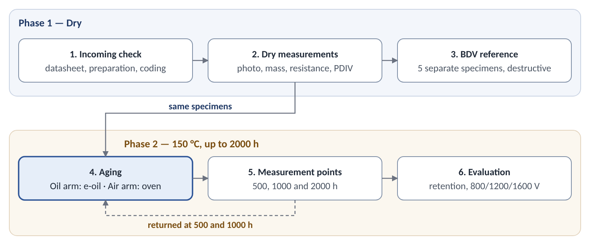

# Basic Test Plan for Hairpin Insulation

The test has two phases. In Phase 1 the specimens are measured dry. In Phase 2 the same specimens are aged at 150 °C for 2000 h: half in e-oil (oil arm) and half in air (air arm). The measurements are repeated at 500, 1000 and 2000 h.

The plan is limited to five basic tests: photographs, mass/thickness, insulation resistance, PDIV and breakdown voltage (BDV). Each specimen is evaluated against its own dry value; the air arm separates the effect of heat from the effect of oil.

## 1. Specimens

| Code | Insulation | Source | Cross-section (mm) | Note |
| --- | --- | --- | --- | --- |
| K | Polyimide (Kapton) tape | Stock, ~15 kg | 4.35 × 2.10 | — |
| KC | Kapton tape + glass | Stock, 4 kg | 4.35 × 2.10 | ≈49 m; enough for the plan |
| C | Glass-fiber insulated | Stock, 29 kg | 4.35 × 2.10 | — |
| E | Enamel | Stock, 100 kg | 5.60 × 2.25 | Different cross-section |
| FC | Film + glass | Stock, 52 kg | 7.15 × 2.05 | Optional; different cross-section |
| PX | Extruded PEEK | Request: purchase | 4.35 × 2.10 | Insulation thickness and class from supplier data |
| PT | PEEK tube | Request: tube | 4.35 × 2.10 | Slid onto bare copper; air gap is checked |
| PS | PEEK heat-shrink sleeve | Request: sleeve | 4.35 × 2.10 | Shrunk onto bare copper; air gap is checked |
| EP | Epoxy powder coating | Request: coating service | 4.35 × 2.10 | On straight copper pieces; thickness specified |
| PA | Parylene HT over enamel | Request: coating service | 5.60 × 2.25 | On E wire, ≤40 µm; compared with E |

Group A (K, KC, C, E, FC) is in stock. Group B (PX, PT, PS, EP, PA) will be requested; each material needs at least 20 m (Section 6). Group B materials are tested with the same plan when they arrive.

Specimen types:

- **Straight specimen:** 300 mm. One end is stripped 15 mm for connection; the other end and the insulation edge at the stripped end are sealed with oil-resistant epoxy. Photographs, mass/thickness and BDV are done on these specimens.
- **Back-to-back pair:** two straight specimens are laid with their wide faces together, offset by 150 mm; the contact length is 150 mm and the stripped ends point outward. The pair is joined with PTFE tape or a clamp only during measurement; during aging the specimens are kept apart. At every measurement the same two specimens are joined in the same position. Used for insulation resistance and PDIV.
- **Open-end specimen:** 300 mm; one end left open and stripped 20 mm. Used to photograph corrosion at the cut end.
- **Copper witness strip:** bare copper, 6 × 25 mm; 3 pairs in each oil vessel, with one strip of each pair in the oil and one above it. Shows how corrosive the oil is.

Preparation: specimens are handled with nitrile gloves, wiped with isopropanol in the same way for all families, and marked with an oil-resistant code. Before measurement they are kept at 23 ± 2 °C and 50 ± 5% relative humidity for at least 24 h.

## 2. Test flow

### Phase 1 — Dry

1. Incoming check: datasheets and batch information are collected; specimens are cut, their ends are prepared, and they are coded.
2. Dry measurements: tracked specimens are photographed, weighed and measured for thickness; insulation resistance and PDIV are measured on the pairs.
3. BDV reference: breakdown voltage is measured on 5 separate straight specimens.

### Phase 2 — In oil

4. Aging: half of the tracked specimens go into e-oil in a closed vessel (oil arm) and half into an air oven (air arm), both at 150 °C. The BDV sets go into the same arms. The water content of the fresh oil is measured; 3 pairs of witness strips are placed in each oil vessel.
5. Measurement points (500, 1000 and 2000 h): the vessels are cooled to room temperature; tracked specimens are removed, surface oil is taken off with absorbent paper, and the specimens are conditioned for 24 h. The Phase 1 measurements are repeated in the same order, and that point's BDV set is tested (5 per arm). An oil sample is taken and one pair of witness strips is removed. At 500 and 1000 h the tracked specimens go back into the same vessel or oven.
6. Evaluation: retention, oil effect and the 800/1200/1600 V verdict (Section 5).

## 3. Tests and how to run them

Measurements are done in the same order at the start and at every measurement point: photographs, mass and thickness, insulation resistance, PDIV. BDV is done on separate specimens. Each record holds the specimen code, phase, aging time, date, temperature and relative humidity.

| Test | Method / standard | Specimen | Result |
| --- | --- | --- | --- |
| Photographs | Photographs with a color card; ΔE per ASTM D2244 if needed | Straight, open-end, witness strip | Visual findings |
| Mass, thickness | IEC 60851-2; 0.1 mg balance, micrometer | Straight | Change (%) |
| Insulation resistance | IEC 60034-27-4 approach; 500 V DC | Pair | R60 |
| PDIV / PDEV | IEC 60270 measuring system; 50 Hz AC, 10 pC | Pair | Vrms and Vpp |
| Breakdown voltage (BDV) | IEC 60851-5; 50 Hz AC | Straight, destructive | kV rms |
| Water content of oil | Karl Fischer (IEC 60814 / ASTM D6304) | Oil | ppm |
| Witness strip | ASTM D130 tarnish scale | Copper strip | Class (1a–4c) |

### 3.1 Photographs

- The camera is mounted on a fixed stand; distance, lens, focus and lighting are the same for every shot. Lighting is diffuse and daylight-colored; no flash is used.
- Every frame includes a color card and a ruler; images are saved as RAW.
- The same two areas are photographed on each specimen: the middle of the straight section and the cut end. On open-end specimens the stripped copper is photographed as well.
- Visible changes are noted: color, cracks, blisters, tape lifting, and green or black products at the cut end.

### 3.2 Mass and thickness

- Insulated thickness and width are measured with a micrometer (0.001 mm) at 5 marked points on the specimen; the same points are measured at every measurement point.
- The specimen is weighed on a balance with 0.1 mg resolution.
- Results are given as percentage change. A mass gain mostly shows oil uptake; a loss shows material loss.

### 3.3 Insulation resistance

- One conductor of the pair is connected to the high-voltage terminal of the megohmmeter and the other to the return terminal.
- 500 V DC is applied and the value at 60 s (R60) is read. The specimen is discharged after the measurement.

### 3.4 PDIV and PDEV

- The partial discharge measuring system is calibrated with a charge calibrator at the start of each session. Background noise must be below 5 pC.
- A 50 Hz AC voltage is applied between the two conductors of the pair and raised from zero at about 50 V/s.
- The voltage at which partial discharge exceeds 10 pC is read as PDIV. The voltage is then lowered at the same rate; the voltage at which discharge falls below 10 pC is read as PDEV.
- The voltage is raised to at most 3.5 kV rms (≈9.9 kVpp), which covers the highest target (1600 V, P/P). If there is no discharge up to this value, the result is recorded as "> 3.5 kV rms".
- Three readings are taken on each pair, 60 s apart; the mean and the lowest value are recorded. Values are reported in Vrms and Vpp (= Vrms × 2√2).

### 3.5 Breakdown voltage (BDV)

- This is a destructive test; a tested specimen is not reused.
- The straight specimen is tested with the rectangular-wire arrangement of IEC 60851-5: it is embedded in metal shot, or its middle section is wrapped in metal foil. The ends stay outside the electrode.
- A 50 Hz AC voltage is applied between the conductor and the shot or foil and raised at the rate given in the standard (e.g., 500 V/s) until breakdown.
- Five specimens are tested at the start, and five per arm at each measurement point; the mean, the lowest value and the breakdown location are recorded.

### 3.6 Oil and witness strips

- The water content of the oil is measured by Karl Fischer titration: in fresh oil, and at each measurement point from the oil vessels. The sample is taken into a dry, closed bottle once the vessel has cooled.
- After 2000 h, 100 mL of oil from each vessel is kept in a dark glass bottle; acidity or metal analysis can be ordered later if needed.
- One pair of witness strips is removed at each measurement point. The strips are rinsed with a sulfur-free solvent (e.g., isooctane), dried and compared with the ASTM D130 tarnish scale. The strip in the oil and the strip above it are rated separately and photographed.

## 4. Aging conditions

| Arm | Medium | Temperature | Measurement points |
| --- | --- | --- | --- |
| Oil arm | Full immersion in e-oil, closed stainless steel vessel | 150 °C | 500 / 1000 / 2000 h |
| Air arm | Air-circulating oven | 150 °C | 500 / 1000 / 2000 h |

- The 1000 h point matches the oil-resistance duration of IEC 60851-4 Test 20; 500 and 2000 h show the trend. 150 °C is the upper limit of this test.
- Each family ages in its own vessel, so products released by one insulation do not affect another. All vessels use the same batch of e-oil.
- Each vessel has pressure relief and a PTFE gasket. Oil fills 65–75% of the vessel; specimens take up at most 5% of the vessel volume.
- The temperature must be at least 20 K below the flash/fire point of the oil; otherwise it is lowered.
- Vessels are cooled to room temperature before opening. While measurements are running, the vessels stay closed at room temperature and the oven is switched off; aging time counts only the time spent at 150 °C.
- The oil is not changed or topped up during aging.

## 5. Evaluation

The main criterion is retention: the value at a measurement point divided by the dry value, on the same specimen. The oil effect is the difference between oil-arm and air-arm retention at the same aging time. Retention is plotted against 500, 1000 and 2000 h to show the trend.

PDIV is also assessed against the DC bus voltage classes. The back-to-back pair represents both the turn-to-turn (T/T) path and the zero-gap phase-to-phase (P/P) path. Targets apply at room temperature (kVpp; two-level inverter, overshoot factor 1.2–1.5; IEC 60034-18-41 approach):

| Path | Specimen state | 800 V | 1200 V | 1600 V |
| --- | --- | --- | --- | --- |
| T/T | Dry (Phase 1) | 1.31–1.64 | 1.97–2.46 | 2.62–3.28 |
| T/T | Aged (Phase 2) | 1.09–1.37 | 1.64–2.05 | 2.18–2.73 |
| P/P | Dry (Phase 1) | 3.74–4.68 | 5.62–7.02 | 7.49–9.36 |
| P/P | Aged (Phase 2) | 3.12–3.90 | 4.68–5.85 | 6.24–7.80 |

Proposed acceptance criteria:

- PDIV retention of at least 50% at 2000 h.
- The lowest PDIV across the measurement points meets the aged target of the class.
- BDV retention and visual findings (color, cracks, blisters, corrosion at the cut end) are reported.

Limitation: PDIV is measured only at room temperature and on specimens wiped free of oil. According to the literature, PDIV can be lower on a hot, oil-wet surface.

## 6. Specimen count and schedule

| Set | Per family | Contents |
| --- | --- | --- |
| Tracked (oil and air arms) | 26 | Per arm: 10 straight specimens (5 pairs) and 3 open-end specimens |
| BDV | 35 | 5 at the start; 5 per arm at 500, 1000 and 2000 h |
| Total | 61 | ≈18 m; ≈1.5 kg at 4.35 × 2.10 |

The four Group A families (K, KC, C, E) need about 245 specimens; adding FC takes 61 more. At least 20 m of each Group B material should be requested (61 specimens ≈ 18 m, plus spare).

Phase 1 takes about 2 weeks. In Phase 2, 2000 h of aging takes about 12 weeks, and the three measurement points add about 3 weeks. The total is about 17 weeks (≈4 months). Group B follows the same schedule once its materials arrive.

## 7. Eliminated tests

The following tests were removed from the basic plan; they can be added back if resources and time allow.

| Eliminated | Reason | If needed |
| --- | --- | --- |
| Capacitance, tan δ | Needs extra equipment; PDIV and insulation resistance show the basic change | With an LCR meter on the same pairs |
| Impulse PDIV (RPDIV) | Needs a dedicated impulse generator; for a two-conductor model, AC PDIV is taken as roughly equivalent in Vpp | To verify 800 V |
| PDIV at 150 °C | Needs an oven with high-voltage feedthroughs | Stated as a limitation |
| Phase-to-ground and gapped phase-to-phase PDIV | The back-to-back pair covers the basic need | With a grounded plate |
| Wet-oil and vapor-phase arms | Need extra vessels and specimens | Witness strips partly track the vapor phase |
| Re-measurement after drying | Needs an extra measurement round | To see whether oil uptake is reversible |
| Oil acidity, resistivity, metal analysis | Need an external lab | Using the retained oil sample |
| Bending, adhesion, FTIR, SEM/EDS, cross-sections | Need extra preparation and external services | Only if visible damage appears |
| Aging and corrosion under voltage | Out of scope | In a separate study |

Open decisions: which e-oil to use and its flash point, whether 150 °C is suitable, access to a partial discharge measuring system, whether FC is included, and the supply schedule for Group B materials.
