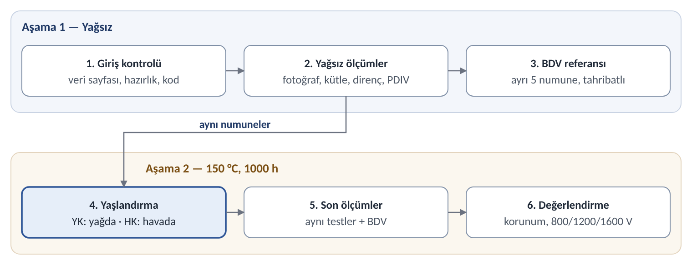

# Hairpin Yalıtımları Temel Test Planı

Test iki aşamadan oluşur. Aşama 1'de numuneler yağsız ölçülür. Aşama 2'de aynı numuneler 150 °C'de 1000 h yaşlandırılır: yarısı e-yağda (YK), yarısı havada (HK). Ardından aynı ölçümler tekrarlanır.

Plan beş temel testle sınırlıdır: fotoğraf, kütle/kalınlık, yalıtım direnci, PDIV ve delinme gerilimi (BDV). Her numune kendi yağsız değerine göre değerlendirilir; hava kolu, ısının etkisini yağın etkisinden ayırır.

## 1. Numuneler

| Kod | Yalıtım | Kesit (mm) | Not |
| --- | --- | --- | --- |
| K | Poliimid (Kapton) bant | 4,35 × 2,10 | Stok |
| KC | Kapton bant + cam | 4,35 × 2,10 | Stok (4 kg) |
| C | Cam izole | 4,35 × 2,10 | Stok |
| E | Emaye | 5,60 × 2,25 | Stok; kesit farklı |
| FC | Folyo + cam (opsiyonel) | 7,15 × 2,05 | Stok |
| B grubu | Ekstrüde PEEK, PEEK tüp, PEEK makaron, epoksi toz, parylene | 4,35 × 2,10 | Malzeme hazır olunca aynı planla |

Numune tipleri:

- **Düz numune:** 300 mm. Bir ucu bağlantı için 15 mm soyulur; diğer uç ve soyulan uçtaki yalıtım kenarı yağa dayanıklı epoksiyle kapatılır. Fotoğraf, kütle/kalınlık ve BDV bu numunelerde yapılır.
- **Sırt sırta çift:** iki düz numune 150 mm kaydırılarak geniş yüzleri üst üste gelecek şekilde konur; temas boyu 150 mm'dir ve soyulmuş uçlar dışa bakar. Çift yalnız ölçüm sırasında PTFE bant veya kelepçeyle birleştirilir; yaşlandırmada numuneler ayrıdır. Sonda aynı iki numune aynı konumda yeniden birleştirilir. Yalıtım direnci ve PDIV için.
- **Açık uçlu numune:** 300 mm; bir ucu açık ve 20 mm soyulmuş. Kesik uçta korozyonu fotoğraflamak için.
- **Bakır tanık şerit:** 6 × 25 mm çıplak bakır; her yağ kabında biri yağda, biri yağın üstünde. Yağın korozifliğini gösterir.

Hazırlık: numuneler nitril eldivenle tutulur, tüm ailelerde aynı şekilde izopropanolle silinir ve yağa dayanıklı bir kodla işaretlenir. Ölçümlerden önce 23 ± 2 °C ve %50 ± 5 bağıl nemde en az 24 h bekletilir.

## 2. Test akışı

### Aşama 1 — Yağsız

1. Giriş kontrolü: veri sayfası ve parti bilgisi toplanır; numuneler kesilir, uçları hazırlanır ve kodlanır.
2. Yağsız ölçümler: izlenen numuneler fotoğraflanır, tartılır ve kalınlıkları ölçülür; çiftlerde yalıtım direnci ve PDIV ölçülür.
3. BDV referansı: ayrı 5 düz numunede delinme gerilimi ölçülür.

### Aşama 2 — Yağlı

4. Yaşlandırma: izlenen numunelerin yarısı kapalı kapta e-yağa (YK), yarısı hava fırınına (HK) konur; ikisi de 150 °C'de 1000 h. BDV için ayrılan 5'er numune de aynı kollara girer. Taze yağın su içeriği ölçülür; YK kabına tanık şeritler konur.
5. Son ölçümler: kaplar oda sıcaklığına soğutulur; numuneler çıkarılır, yüzey yağı emici kâğıtla alınır ve numuneler 24 h kondisyonlanır. Aşama 1'deki ölçümler aynı sırayla tekrarlanır; her kolda 5 numunede BDV ölçülür. Yağın su içeriği ölçülür, tanık şeritler derecelendirilir.
6. Değerlendirme: korunum, yağ etkisi ve 800/1200/1600 V hükmü (Bölüm 5).

## 3. Testler ve nasıl yapılır

Ölçümler her seferinde aynı sırayla yapılır: fotoğraf, kütle ve kalınlık, yalıtım direnci, PDIV. BDV ayrı numunelerde yapılır. Her kayıtta numune kodu, aşama, tarih, sıcaklık ve bağıl nem bulunur.

| Test | Yöntem / standart | Numune | Sonuç |
| --- | --- | --- | --- |
| Fotoğraf | Renk kartlı fotoğraf; ΔE istenirse ASTM D2244 | Düz, açık uçlu, tanık şerit | Görsel bulgular |
| Kütle, kalınlık | IEC 60851-2; 0,1 mg terazi, mikrometre | Düz | Değişim (%) |
| Yalıtım direnci | IEC 60034-27-4 yaklaşımı; 500 V DC | Çift | R60 |
| PDIV / PDEV | IEC 60270 ölçüm sistemi; 50 Hz AC, 10 pC | Çift | Vrms ve Vpp |
| Delinme gerilimi (BDV) | IEC 60851-5; 50 Hz AC | Düz, tahribatlı | kV rms |
| Yağın su içeriği | Karl Fischer (IEC 60814 / ASTM D6304) | Yağ | ppm |
| Tanık şerit | ASTM D130 kararma ölçeği | Bakır şerit | Sınıf (1a–4c) |

### 3.1 Fotoğraf

- Kamera sabit bir standa takılır; mesafe, lens, odak ve ışık her çekimde aynıdır. Işık dağınık ve gün ışığı renginde olur; flaş kullanılmaz.
- Her karede renk kartı ve cetvel bulunur; görüntü RAW olarak kaydedilir.
- Her numunede aynı iki bölge çekilir: düz bölümün ortası ve kesik uç. Açık uçlu numunede soyulmuş bakır da çekilir.
- Görülen değişim not edilir: renk, çatlak, kabarma, bant açılması, kesik uçta yeşil veya siyah ürün.

### 3.2 Kütle ve kalınlık

- Yalıtımlı kalınlık ve genişlik, numunede işaretli 5 noktada mikrometreyle (0,001 mm) ölçülür; sonda aynı noktalar ölçülür.
- Numune 0,1 mg hassasiyetli terazide tartılır.
- Sonuç yüzde değişim olarak verilir. Kütle artışı çoğunlukla yağ emilimini, azalma malzeme kaybını gösterir.

### 3.3 Yalıtım direnci

- Çiftin bir iletkeni megohmmetrenin yüksek gerilim ucuna, diğeri dönüş ucuna bağlanır.
- 500 V DC uygulanır ve 60 s sonundaki değer (R60) okunur. Ölçümden sonra numune deşarj edilir.

### 3.4 PDIV ve PDEV

- Kısmi deşarj ölçüm sistemi her oturumun başında yük kalibratörüyle kalibre edilir. Arka plan gürültüsü 5 pC'nin altında olmalıdır.
- 50 Hz AC gerilim çiftin iki iletkeni arasına uygulanır ve sıfırdan yaklaşık 50 V/s hızla artırılır.
- Kısmi deşarj 10 pC'yi aştığında gerilim PDIV olarak okunur. Ardından gerilim aynı hızla düşürülür; deşarj 10 pC'nin altına indiğinde gerilim PDEV olarak okunur.
- Gerilim en çok 3,5 kV rms'ye (≈9,9 kVpp) çıkarılır; bu, en yüksek hedefi (1600 V, P/P) kapsar. Bu değere kadar deşarj yoksa sonuç "> 3,5 kV rms" olarak yazılır.
- Her çiftte 60 s arayla 3 okuma yapılır; ortalama ve en düşük değer kaydedilir. Değerler Vrms ve Vpp (= Vrms × 2√2) olarak raporlanır.

### 3.5 Delinme gerilimi (BDV)

- Tahribatlı testtir; ölçülen numune yeniden kullanılmaz.
- Düz numune IEC 60851-5'teki dikdörtgen tel düzeniyle test edilir: numune metal bilye içine gömülür ya da orta bölümü metal folyoyla sarılır. Uçlar elektrodun dışında kalır.
- 50 Hz AC gerilim iletken ile bilye veya folyo arasına uygulanır ve standarttaki hızla (ör. 500 V/s) delinmeye kadar artırılır.
- Her ölçüm noktasında 5 numune ölçülür; ortalama, en düşük değer ve delinme yeri kaydedilir.

### 3.6 Yağ ve tanık şerit

- Yağın su içeriği Karl Fischer yöntemiyle ölçülür: taze yağda ve 1000 h sonunda YK kabından. Örnek, kap soğuyunca kuru ve kapalı bir şişeye alınır.
- Ayrıca 100 mL yağ örneği koyu cam şişede saklanır; gerekirse sonra asitlik veya metal analizi yaptırılır.
- Tanık şeritler kükürtsüz bir çözücüyle (ör. izooktan) yıkanır, kurutulur ve ASTM D130 kararma ölçeğiyle karşılaştırılır. Yağdaki ve yağ üstündeki şerit ayrı derecelendirilir ve fotoğraflanır.

## 4. Yaşlandırma koşulları

| Kol | Ortam | Sıcaklık | Süre |
| --- | --- | --- | --- |
| YK | E-yağa tam daldırma, kapalı paslanmaz çelik kap | 150 °C | 1000 h |
| HK | Hava sirkülasyonlu fırın | 150 °C | 1000 h |

- 1000 h, IEC 60851-4 Test 20'nin yağ dayanımı süresidir; 150 °C bu testin üst sınırıdır.
- Her aile ayrı kapta yaşlanır; böylece bir yalıtımdan çıkan ürünler diğerini etkilemez. Tüm kaplarda aynı e-yağ partisi kullanılır.
- Kap basınç tahliyelidir ve PTFE contalıdır. Yağ kabın %65–75'ini doldurur; numuneler kap hacminin en çok %5'ini kaplar.
- Sıcaklık yağın parlama/yanma noktasının en az 20 K altında olmalı; değilse düşürülür.
- Kap açılmadan önce oda sıcaklığına soğutulur; yaşlandırma boyunca yağ değiştirilmez.

## 5. Değerlendirme

Ana ölçüt korunumdur: son değer / yağsız değer, aynı numunede. Yağın etkisi, aynı süredeki YK korunumu ile HK korunumu arasındaki farktır.

PDIV ayrıca DC bara sınıflarına göre değerlendirilir. Sırt sırta çift hem dönüş-dönüş (T/T) hem de sıfır aralıklı faz-faz (P/P) yolunu temsil eder. Hedefler oda sıcaklığı içindir (kVpp; iki seviyeli evirici, aşma faktörü 1,2–1,5; IEC 60034-18-41 yaklaşımı):

| Yol | Numune durumu | 800 V | 1200 V | 1600 V |
| --- | --- | --- | --- | --- |
| T/T | Yağsız (Aşama 1) | 1,31–1,64 | 1,97–2,46 | 2,62–3,28 |
| T/T | Yaşlanmış (Aşama 2) | 1,09–1,37 | 1,64–2,05 | 2,18–2,73 |
| P/P | Yağsız (Aşama 1) | 3,74–4,68 | 5,62–7,02 | 7,49–9,36 |
| P/P | Yaşlanmış (Aşama 2) | 3,12–3,90 | 4,68–5,85 | 6,24–7,80 |

Önerilen kabul ölçütleri:

- PDIV korunumu en az %50.
- En düşük PDIV değeri ilgili sınıfın hedefini karşılamalı.
- BDV korunumu ve görsel bulgular (renk, çatlak, kabarma, kesik uçta korozyon) raporlanır.

Sınırlama: PDIV yalnız oda sıcaklığında ve yağ silinmiş numunede ölçülür. Literatüre göre sıcak ve yağla ıslak yüzeyde PDIV daha düşük olabilir.

## 6. Numune sayısı ve takvim

| Set | Aile başına | İçerik |
| --- | --- | --- |
| İzlenen (YK + HK) | 26 | Her kolda 10 düz numune (5 çift) ve 3 açık uçlu numune |
| BDV | 15 | Başta 5; sonda YK'da 5, HK'da 5 |
| Toplam | 41 | ≈12 m; 4,35 × 2,10 kesitte ≈1 kg |

Dört stok ailesi (K, KC, C, E) için toplam yaklaşık 165 numune gerekir. Aşama 1 yaklaşık 2 hafta, Aşama 2 ise 1000 h (yaklaşık 6 hafta) ve 1 haftalık son ölçümler sürer. Toplam süre yaklaşık 9–10 haftadır.

## 7. Elenen testler

Aşağıdaki testler temel plandan çıkarıldı; kaynak ve zaman olursa eklenebilir.

| Elenen | Neden | Gerekirse |
| --- | --- | --- |
| Kapasitans, tan δ | Ek cihaz ister; PDIV ve yalıtım direnci temel değişimi gösterir | LCR ölçerle aynı çiftlerde |
| Darbe PDIV (RPDIV) | Özel darbe üreteci ister; iki iletkenli modelde AC PDIV, Vpp cinsinden yaklaşık eşdeğer kabul edilir | 800 V doğrulaması için |
| 150 °C'de PDIV | Yüksek gerilim geçişli fırın ister | Sınırlama olarak yazılır |
| Faz-toprak ve aralıklı faz-faz PDIV | Sırt sırta çift temel ihtiyacı karşılar | Topraklı plakayla |
| Islak yağ ve buhar fazı kolları | Ek kap ve numune ister | Tanık şerit buhar fazını kısmen izler |
| Ara ölçüm (500 h) ve 2000 h | Süreyi uzatır | 1000 h sonrası devam |
| Kurutma sonrası tekrar ölçüm | Ek ölçüm turu ister | Emilimin geri dönüp dönmediğini görmek için |
| Yağ asitliği, özdirenç, metal analizi | Dış laboratuvar ister | Saklanan yağ örneğiyle |
| Büküm, yapışma, FTIR, SEM/EDS, kesit | Ek hazırlık ve dış hizmet ister | Yalnız görünür hasar varsa |
| Gerilim altında yaşlandırma ve korozyon | Kapsam dışı | Ayrı bir çalışmada |

Açık kararlar: kullanılacak e-yağ ve parlama noktası, 150 °C'nin uygunluğu, kısmi deşarj ölçüm cihazına erişim ve FC ile B grubunun zamanlaması.
