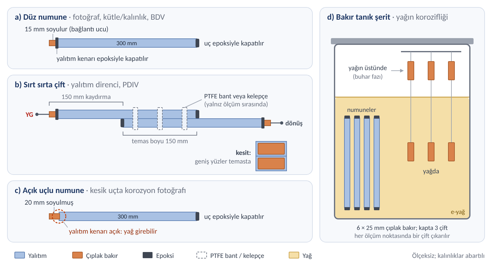
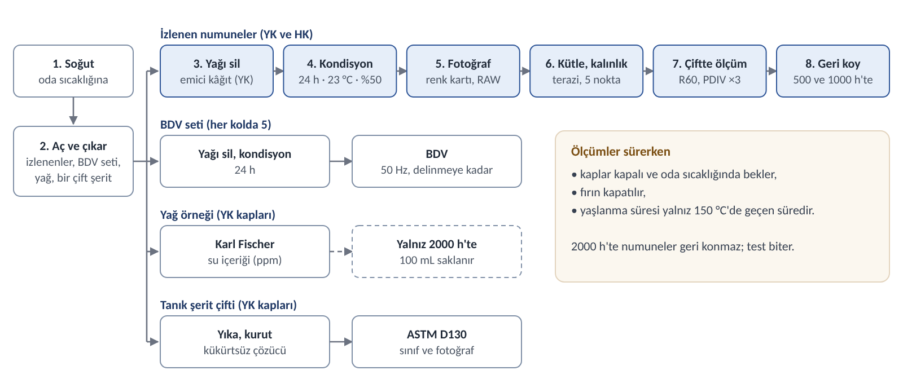
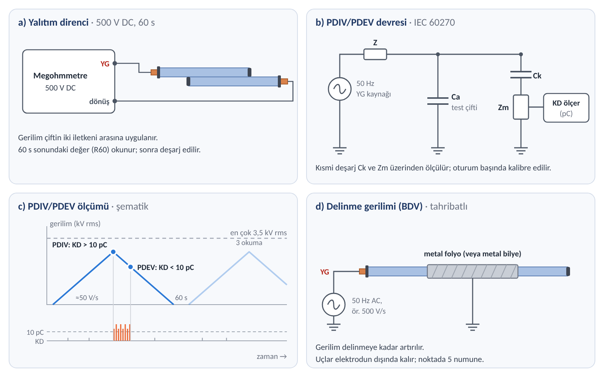
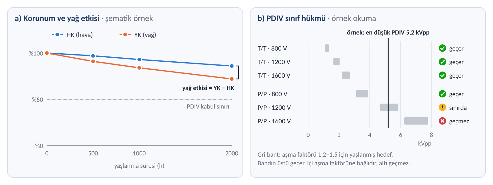
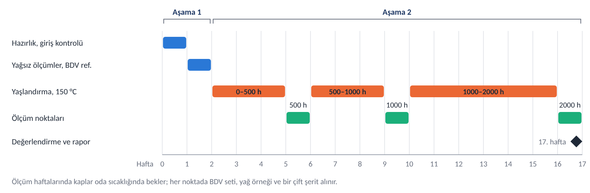

# Hairpin Yalıtımları Temel Test Planı

Test iki aşamadan oluşur. Aşama 1'de numuneler yağsız ölçülür. Aşama 2'de aynı numuneler 150 °C'de 2000 h yaşlandırılır: yarısı e-yağda (YK), yarısı havada (HK). Ölçümler 500, 1000 ve 2000 h'te tekrarlanır.

Plan beş temel testle sınırlıdır: fotoğraf, kütle/kalınlık, yalıtım direnci, PDIV ve delinme gerilimi (BDV). Her numune kendi yağsız değerine göre değerlendirilir; hava kolu, ısının etkisini yağın etkisinden ayırır.

## 1. Numuneler

| Kod | Yalıtım | Kaynak | Kesit (mm) | Not |
| --- | --- | --- | --- | --- |
| K | Poliimid (Kapton) bant | Stok, ~15 kg | 4,35 × 2,10 | — |
| KC | Kapton bant + cam | Stok, 4 kg | 4,35 × 2,10 | ≈49 m; plan için yeterli |
| C | Cam izole | Stok, 29 kg | 4,35 × 2,10 | — |
| E | Emaye | Stok, 100 kg | 5,60 × 2,25 | Kesit farklı |
| FC | Folyo + cam | Stok, 52 kg | 7,15 × 2,05 | Opsiyonel; kesit farklı |
| PX | Ekstrüde PEEK | Talep: tedarik | 4,35 × 2,10 | Yalıtım kalınlığı ve sınıfı üretici verisiyle |
| PT | PEEK tüp | Talep: tüp | 4,35 × 2,10 | Çıplak bakıra geçirilir; hava boşluğu kontrol edilir |
| PS | PEEK ısıyla büzüşen makaron | Talep: makaron | 4,35 × 2,10 | Çıplak bakıra büzülür; hava boşluğu kontrol edilir |
| EP | Epoksi toz kaplama | Talep: hizmet alımı | 4,35 × 2,10 | Düz bakır parçalara; kalınlık belirtilir |
| PA | Parylene HT, emaye üstü | Talep: hizmet alımı | 5,60 × 2,25 | E teli üzerine, ≤40 µm; E ile karşılaştırılır |

A grubu (K, KC, C, E, FC) stokta vardır. B grubu (PX, PT, PS, EP, PA) talep edilecektir; her biri için en az 20 m gerekir (Bölüm 6). B grubu malzemeleri geldiğinde aynı planla test edilir.

Numune tipleri (Şekil 1):

- **Düz numune:** 300 mm. Bir ucu bağlantı için 15 mm soyulur; diğer uç ve soyulan uçtaki yalıtım kenarı yağa dayanıklı epoksiyle kapatılır. Fotoğraf, kütle/kalınlık ve BDV bu numunelerde yapılır.
- **Sırt sırta çift:** iki düz numune 150 mm kaydırılarak geniş yüzleri üst üste gelecek şekilde konur; temas boyu 150 mm'dir ve soyulmuş uçlar dışa bakar. Çift yalnız ölçüm sırasında PTFE bant veya kelepçeyle birleştirilir; yaşlandırmada numuneler ayrıdır. Her ölçümde aynı iki numune aynı konumda birleştirilir. Yalıtım direnci ve PDIV için.
- **Açık uçlu numune:** 300 mm. Bir ucu 20 mm soyulur ve yalıtım kenarı açık bırakılır; diğer ucu epoksiyle kapatılır. Motordaki kaynak ucunu temsil eder; kesik uçtaki korozyon fotoğraflanır.
- **Bakır tanık şerit:** 6 × 25 mm çıplak bakır; her yağ kabında 3 çift, her çiftte biri yağda, biri yağın üstünde. Yağın korozifliğini gösterir.

**Uçlar neden kapatılır?** Numune telden kesildiği için uçlarında bakır ve yalıtımın kesiti açıkta kalır; motordaki sargıda ise yalıtım kesintisizdir. Açık kesik uçtan yağ yalıtımın altına girer (özellikle bant ve cam yalıtımda) ve sonuçlar yalıtımın kendisini değil kesik ucu yansıtır. Bu yüzden düz numunenin uçları 150 °C'ye ve yağa dayanıklı epoksiyle kapatılır; soyulmuş 15 mm yalnız ölçüm kablosunun bağlantısı içindir. Motorda yalıtımın açıkta bittiği yer, kaynak için soyulan hairpin uçlarıdır. Açık uçlu numune bu bölgeyi temsil eder: yağın yalıtım kenarından girip bakırı aşındırıp aşındırmadığını gösterir.

Hazırlık: numuneler nitril eldivenle tutulur, tüm ailelerde aynı şekilde izopropanolle silinir ve yağa dayanıklı bir kodla işaretlenir. Ölçümlerden önce 23 ± 2 °C ve %50 ± 5 bağıl nemde en az 24 h bekletilir.

## 2. Test akışı

### Aşama 1 — Yağsız

1. Giriş kontrolü: veri sayfası ve parti bilgisi toplanır; numuneler kesilir, uçları hazırlanır ve kodlanır.
2. Yağsız ölçümler: izlenen numuneler fotoğraflanır, tartılır ve kalınlıkları ölçülür; çiftlerde yalıtım direnci ve PDIV ölçülür.
3. BDV referansı: ayrı 5 düz numunede delinme gerilimi ölçülür.

### Aşama 2 — Yağlı

4. Yaşlandırma: izlenen numunelerin yarısı kapalı kapta e-yağa (YK), yarısı hava fırınına (HK) konur; ikisi de 150 °C'de. BDV setleri de aynı kollara girer. Taze yağın su içeriği ölçülür; her yağ kabına 3 çift tanık şerit konur.
5. Ölçüm noktaları (500, 1000 ve 2000 h): kaplar oda sıcaklığına soğutulur; izlenen numuneler çıkarılır, yüzey yağı emici kâğıtla alınır ve numuneler 24 h kondisyonlanır. Aşama 1'deki ölçümler aynı sırayla tekrarlanır ve o noktanın BDV seti ölçülür (her kolda 5). Yağ örneği alınır ve bir çift tanık şerit çıkarılır. 500 ve 1000 h'te izlenen numuneler aynı kaba veya fırına geri konur.
6. Değerlendirme: korunum, yağ etkisi ve 800/1200/1600 V hükmü (Bölüm 5).

Bir ölçüm noktasındaki iş sırası Şekil 3'te gösterilmiştir:

## 3. Testler ve nasıl yapılır

Ölçümler başta ve her ölçüm noktasında aynı sırayla yapılır: fotoğraf, kütle ve kalınlık, yalıtım direnci, PDIV. BDV ayrı numunelerde yapılır. Her kayıtta numune kodu, aşama, yaşlanma süresi, tarih, sıcaklık ve bağıl nem bulunur.

| Test | Yöntem / standart | Numune | Sonuç |
| --- | --- | --- | --- |
| Fotoğraf | Renk kartlı fotoğraf; ΔE istenirse ASTM D2244 | Düz, açık uçlu, tanık şerit | Görsel bulgular |
| Kütle, kalınlık | IEC 60851-2; 0,1 mg terazi, mikrometre | Düz | Değişim (%) |
| Yalıtım direnci | IEC 60034-27-4 yaklaşımı; 500 V DC | Çift | R60 |
| PDIV / PDEV | IEC 60270 ölçüm sistemi; 50 Hz AC, 10 pC | Çift | Vrms ve Vpp |
| Delinme gerilimi (BDV) | IEC 60851-5; 50 Hz AC | Düz, tahribatlı | kV rms |
| Yağın su içeriği | Karl Fischer (IEC 60814 / ASTM D6304) | Yağ | ppm |
| Tanık şerit | ASTM D130 kararma ölçeği | Bakır şerit | Sınıf (1a–4c) |

### 3.1 Fotoğraf

- Kamera sabit bir standa takılır; mesafe, lens, odak ve ışık her çekimde aynıdır. Işık dağınık ve gün ışığı renginde olur; flaş kullanılmaz.
- Her karede renk kartı ve cetvel bulunur; görüntü RAW olarak kaydedilir.
- Her numunede aynı iki bölge çekilir: düz bölümün ortası ve kesik uç. Açık uçlu numunede soyulmuş bakır da çekilir.
- Görülen değişim not edilir: renk, çatlak, kabarma, bant açılması, kesik uçta yeşil veya siyah ürün.

### 3.2 Kütle ve kalınlık

- Yalıtımlı kalınlık ve genişlik, numunede işaretli 5 noktada mikrometreyle (0,001 mm) ölçülür; her ölçüm noktasında aynı noktalar ölçülür.
- Numune 0,1 mg hassasiyetli terazide tartılır.
- Epoksinin kendi kütle değişimi düzeltilir: her kapta ve fırında numunelerle birlikte 3 küçük epoksi parçası yaşlandırılır ve tartılır.
- Sonuç yüzde değişim olarak verilir. Kütle artışı çoğunlukla yağ emilimini, azalma malzeme kaybını gösterir.

### 3.3 Yalıtım direnci

- Çiftin bir iletkeni megohmmetrenin yüksek gerilim ucuna, diğeri dönüş ucuna bağlanır (Şekil 4a).
- 500 V DC uygulanır ve 60 s sonundaki değer (R60) okunur. Ölçümden sonra numune deşarj edilir.

### 3.4 PDIV ve PDEV

- Kısmi deşarj ölçüm sistemi her oturumun başında yük kalibratörüyle kalibre edilir. Arka plan gürültüsü 5 pC'nin altında olmalıdır.
- 50 Hz AC gerilim çiftin iki iletkeni arasına uygulanır ve sıfırdan yaklaşık 50 V/s hızla artırılır (devre Şekil 4b, profil Şekil 4c).
- Kısmi deşarj 10 pC'yi aştığında gerilim PDIV olarak okunur. Ardından gerilim aynı hızla düşürülür; deşarj 10 pC'nin altına indiğinde gerilim PDEV olarak okunur.
- Gerilim en çok 3,5 kV rms'ye (≈9,9 kVpp) çıkarılır; bu, en yüksek hedefi (1600 V, P/P) kapsar. Bu değere kadar deşarj yoksa sonuç "> 3,5 kV rms" olarak yazılır.
- Her çiftte 60 s arayla 3 okuma yapılır; ortalama ve en düşük değer kaydedilir. Değerler Vrms ve Vpp (= Vrms × 2√2) olarak raporlanır.

### 3.5 Delinme gerilimi (BDV)

- Tahribatlı testtir; ölçülen numune yeniden kullanılmaz.
- Düz numune IEC 60851-5'teki dikdörtgen tel düzeniyle test edilir: numune metal bilye içine gömülür ya da orta bölümü metal folyoyla sarılır. Uçlar elektrodun dışında kalır (Şekil 4d).
- 50 Hz AC gerilim iletken ile bilye veya folyo arasına uygulanır ve standarttaki hızla (ör. 500 V/s) delinmeye kadar artırılır.
- Başta 5 numune, her ölçüm noktasında ise her kolda 5 numune ölçülür; ortalama, en düşük değer ve delinme yeri kaydedilir.

### 3.6 Yağ ve tanık şerit

- Yağın su içeriği Karl Fischer yöntemiyle ölçülür: taze yağda ve her ölçüm noktasında YK kaplarından. Örnek, kap soğuyunca kuru ve kapalı bir şişeye alınır.
- 2000 h sonunda her kaptan 100 mL yağ örneği koyu cam şişede saklanır; gerekirse sonra asitlik veya metal analizi yaptırılır.
- Her ölçüm noktasında bir çift tanık şerit çıkarılır. Şeritler kükürtsüz bir çözücüyle (ör. izooktan) yıkanır, kurutulur ve ASTM D130 kararma ölçeğiyle karşılaştırılır. Yağdaki ve yağ üstündeki şerit ayrı derecelendirilir ve fotoğraflanır.

## 4. Yaşlandırma koşulları

| Kol | Ortam | Sıcaklık | Ölçüm noktaları |
| --- | --- | --- | --- |
| YK | E-yağa tam daldırma, kapalı paslanmaz çelik kap | 150 °C | 500 / 1000 / 2000 h |
| HK | Hava sirkülasyonlu fırın | 150 °C | 500 / 1000 / 2000 h |

- 1000 h noktası IEC 60851-4 Test 20'nin yağ dayanımı süresine karşılık gelir; 500 ve 2000 h eğilimi gösterir. 150 °C bu testin üst sınırıdır.
- Her aile ayrı kapta yaşlanır; böylece bir yalıtımdan çıkan ürünler diğerini etkilemez. Tüm kaplarda aynı e-yağ partisi kullanılır.
- Kap basınç tahliyelidir ve PTFE contalıdır. Yağ kabın %65–75'ini doldurur; numuneler kap hacminin en çok %5'ini kaplar.
- Sıcaklık yağın parlama/yanma noktasının en az 20 K altında olmalı; değilse düşürülür.
- Kap açılmadan önce oda sıcaklığına soğutulur. Ölçümler sürerken kaplar kapalı ve oda sıcaklığında bekler, fırın da kapatılır; yaşlanma süresi yalnız 150 °C'de geçen süredir.
- Yaşlandırma boyunca yağ değiştirilmez ve eklenmez.

## 5. Değerlendirme

Ana ölçüt korunumdur: ölçüm noktasındaki değer / yağsız değer, aynı numunede. Yağın etkisi, aynı süredeki YK korunumu ile HK korunumu arasındaki farktır. Korunum 500, 1000 ve 2000 h'e karşı çizilerek eğilim gösterilir (Şekil 5a).

PDIV ayrıca DC bara sınıflarına göre değerlendirilir. Sırt sırta çift hem dönüş-dönüş (T/T) hem de sıfır aralıklı faz-faz (P/P) yolunu temsil eder. Hedefler oda sıcaklığı içindir (kVpp; iki seviyeli evirici, aşma faktörü 1,2–1,5; IEC 60034-18-41 yaklaşımı):

| Yol | Numune durumu | 800 V | 1200 V | 1600 V |
| --- | --- | --- | --- | --- |
| T/T | Yağsız (Aşama 1) | 1,31–1,64 | 1,97–2,46 | 2,62–3,28 |
| T/T | Yaşlanmış (Aşama 2) | 1,09–1,37 | 1,64–2,05 | 2,18–2,73 |
| P/P | Yağsız (Aşama 1) | 3,74–4,68 | 5,62–7,02 | 7,49–9,36 |
| P/P | Yaşlanmış (Aşama 2) | 3,12–3,90 | 4,68–5,85 | 6,24–7,80 |

Önerilen kabul ölçütleri:

- PDIV korunumu 2000 h'te en az %50.
- Ölçüm noktalarındaki en düşük PDIV, ilgili sınıfın yaşlanmış hedefini karşılamalı (okuma örneği: Şekil 5b).
- BDV korunumu ve görsel bulgular (renk, çatlak, kabarma, kesik uçta korozyon) raporlanır.

Sınırlama: PDIV yalnız oda sıcaklığında ve yağ silinmiş numunede ölçülür. Literatüre göre sıcak ve yağla ıslak yüzeyde PDIV daha düşük olabilir.

## 6. Numune sayısı ve takvim

| Set | Aile başına | İçerik |
| --- | --- | --- |
| İzlenen (YK + HK) | 26 | Her kolda 10 düz numune (5 çift) ve 3 açık uçlu numune |
| BDV | 35 | Başta 5; her kolda 500, 1000 ve 2000 h'te 5'er |
| Toplam | 61 | ≈18 m; 4,35 × 2,10 kesitte ≈1,5 kg |

A grubunun dört ailesi (K, KC, C, E) için yaklaşık 245 numune gerekir; FC eklenirse 61 numune daha. B grubundaki her malzeme için en az 20 m talep edilmelidir (61 numune ≈ 18 m, artı yedek).

Aşama 1 yaklaşık 2 hafta sürer. Aşama 2'de 2000 h yaşlandırma yaklaşık 12 hafta sürer; üç ölçüm noktası yaklaşık 3 hafta ekler. Toplam süre yaklaşık 17 haftadır (≈4 ay). B grubu, malzemeler geldiğinde aynı takvimle yürür (Şekil 6).

## 7. Elenen testler

Aşağıdaki testler temel plandan çıkarıldı; kaynak ve zaman olursa eklenebilir:

| Elenen | Neden | Gerekirse |
| --- | --- | --- |
| Kapasitans, tan δ | Ek cihaz ister; PDIV ve yalıtım direnci temel değişimi gösterir | LCR ölçerle aynı çiftlerde |
| Darbe PDIV (RPDIV) | Özel darbe üreteci ister; iki iletkenli modelde AC PDIV, Vpp cinsinden yaklaşık eşdeğer kabul edilir | 800 V doğrulaması için |
| 150 °C'de PDIV | Yüksek gerilim geçişli fırın ister | Sınırlama olarak yazılır |
| Faz-toprak ve aralıklı faz-faz PDIV | Sırt sırta çift temel ihtiyacı karşılar | Topraklı plakayla |
| Islak yağ ve buhar fazı kolları | Ek kap ve numune ister | Tanık şerit buhar fazını kısmen izler |
| Kurutma sonrası tekrar ölçüm | Ek ölçüm turu ister | Emilimin geri dönüp dönmediğini görmek için |
| Yağ asitliği, özdirenç, metal analizi | Dış laboratuvar ister | Saklanan yağ örneğiyle |
| Büküm, yapışma, FTIR, SEM/EDS, kesit | Ek hazırlık ve dış hizmet ister | Yalnız görünür hasar varsa |
| Gerilim altında yaşlandırma ve korozyon | Kapsam dışı | Ayrı bir çalışmada |

Açık kararlar: kullanılacak e-yağ ve parlama noktası, 150 °C'nin uygunluğu, kısmi deşarj ölçüm cihazına erişim, FC'nin dahil edilmesi ve B grubu malzemelerinin tedarik takvimi.
