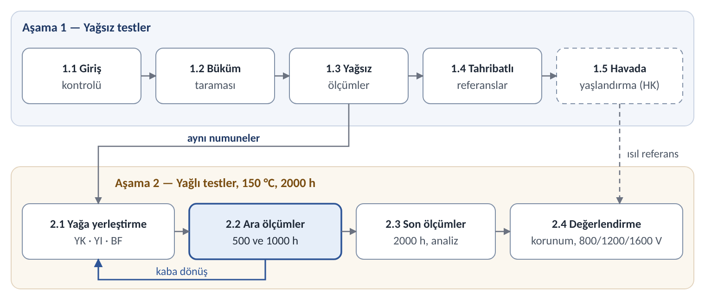

# Hairpin İletken Yalıtımları Test Planı: Yağsız ve Yağlı Aşamalar

Test iki temel aşamadan oluşur. Aşama 1'de numuneler yağsız olarak tanımlanır ve ölçülür; aynı sıcaklıkta havada yaşlanan kontrol seti de bu aşamada başlar. Aşama 2'de aynı numuneler e-yağa alınır, 150 °C'de 2000 h yaşlandırılır ve ölçümler 500, 1000 ve 2000 h'te tekrarlanır.

Her numune kendi yağsız değerine göre değerlendirilir. Havada yaşlanan kontrol, ısının etkisini yağın etkisinden ayırır. Sonuçlar ayrıca 800, 1200 ve 1600 V DC bara sınıflarına göre yorumlanır.

## 1. Amaç ve kapsam

Plan, hairpin yassı iletkenlere uygulanan yalıtımların yağsız ve yağlı koşullarda elektriksel, fiziksel ve görsel değişimini ve bakır korozyonunu ölçer.

Araştırma soruları:

- AS1: Aynı protokolde hangi yalıtım ve uygulama yöntemi özelliklerini en iyi korur?
- AS2: Yağ, yalnız ısının yarattığı değişime ne kadar ek bozulma getirir?
- AS3: Görsel değişim (ΔE, çatlak, kabarma) elektriksel kayıpla ne kadar ilişkili?
- AS4: Korozyon iletkenin hangi bölgesinde başlar; sıvı ve buhar fazında nasıl farklılaşır?
- AS5: Yağda yaşlanma, her yalıtımın taşıyabildiği DC bara gerilimini ne kadar düşürür?

Çıktılar: her aile için yağsız başlangıç değerleri, Aşama 2 korunum eğrileri, izin verilen bara gerilimi Udc,izin(t), korozyon haritası ve yağ analizi tablosu.

## 2. Numuneler ve hazırlık

Karşılaştırma aynı bakır kesitinde yapılır: referans kesit 4,35 × 2,10 mm. Stokta bu kesitte üç yalıtım var; planlanan uygulamalar da bu kesitteki çıplak bakıra yapılır.

**Yalıtım aileleri**

| Kod | Yalıtım | Kaynak | Kesit (mm) | Not |
| --- | --- | --- | --- | --- |
| K | Poliimid (Kapton) bant | Stok, ~15 kg | 4,35 × 2,10 | Yapıştırıcı türü FTIR ile belirlenir |
| KC | Kapton bant + cam | Stok, 4 kg (≈49 m) | 4,35 × 2,10 | Tam matris için sınırda |
| C | Cam izole | Stok, 29 kg | 4,35 × 2,10 | Gözenekli; karşılaştırma sınıfı |
| E | Emaye | Stok, 100 kg | 5,60 × 2,25 | Kimyası FTIR ile belirlenir |
| K2 | Kapton bant (köprü) | Stok, 130 kg | 5,50 × 1,90 | E'yi referans kesite bağlar |
| FC | Folyo + cam (opsiyonel) | Stok, 52 kg | 7,15 × 2,05 | Folyo türü (PET/PI) belirlenir |
| PX | Ekstrüde PEEK | Tedarik | 4,35 × 2,10 | Üretici verisiyle |
| PT | PEEK tüp | Çıplak bakıra uygulama | 4,35 × 2,10 | Hava boşluğu kontrol edilir |
| PS | PEEK ısıyla büzüşen makaron | Çıplak bakıra uygulama | 4,35 × 2,10 | Hava boşluğu kontrol edilir |
| EP | Epoksi toz | Hizmet alımı | 4,35 × 2,10 | Şekillendirmeden sonra uygulanır |
| PA | Parylene HT, emaye üstü | Hizmet alımı | 5,60 × 2,25 (E üzerine) | ≤40 µm |

**Numune geometrileri**

| Kod | Geometri | Kullanım |
| --- | --- | --- |
| D | Düz, 300 mm; kesik uçlar epoksiyle kapalı | Görüntüleme, kütle/kalınlık, BDV, analiz |
| DA | Düz, 300 mm; bir ucu açık ve 20 mm soyulmuş | Kesik uçta ve soyulmuş bölgede korozyon |
| B | Hairpin yarıçapında kenar ve yassı yönde bükülü | Büküm tacında çatlak ve görüntüleme |
| TT | İki D numunesi sırt sırta, 150 mm temas, seramik tutucu | C/tan δ ve T/T PDIV; aralayıcıyla P/P PDIV (0, 50, 100 µm) |
| PG | D numunesi topraklı düz plaka üzerinde | P/G PDIV ve yalıtım direnci |
| F | Hairpin formeti (IEC TS 61857-42 Ek B), opsiyonel | Formet yalıtım direnci ve AC dayanım |
| W | Bakır tanık şerit, 6 × 25 mm | Yağın koroziflik göstergesi; her kapta sıvıda ve buhar fazında |

Numuneler başta setlere ayrılır ve kodlanır. İzlenen setler (YK, YI, BF) Aşama 1'de yağsız ölçülür ve Aşama 2'ye aynı numuneler olarak girer. HK seti yalnız havada yaşlanır; tahribatlı setler her ölçüm noktası için ayrıdır.

**Hazırlık**

1. Elleçleme: nitril eldiven; çıplak elle temas yok (el tuzu nemde PDIV'yi %20–26 düşürür).
2. Temizlik: lif bırakmayan bez ve izopropanol ile tüm ailelerde aynı silme, ardından 30 dk oda sıcaklığında kurutma.
3. Uçlar: D, B, TT ve PG numunelerinin kesik uçları yağa dayanıklı epoksiyle kapatılır; DA numunelerinin ucu açık kalır.
4. Kimlik: her numuneye yağa dayanıklı kalıcı kod; fotoğraf bölgeleri işaretlenir.
5. Kondisyonlama: ölçümlerden önce 23 ± 2 °C ve %50 ± 5 bağıl nemde en az 24 h.

## 3. Genel akış

| Aşama | Adım | Ne yapılır | Numune |
| --- | --- | --- | --- |
| 1 – Yağsız | 1.1 Giriş kontrolü | Veri sayfası, kalınlık, FTIR ile kimlik | Tüm aileler |
| 1 – Yağsız | 1.2 Büküm taraması | Hairpin yarıçapında büküm, çatlak muayenesi | Aile başına 3 |
| 1 – Yağsız | 1.3 Yağsız ölçümler | Tüm tahribatsız ölçümler, oda sıcaklığında ve 150 °C'de | İzlenen setler (YK, YI, BF, HK) |
| 1 – Yağsız | 1.4 Tahribatlı referanslar | BDV, yapışma/soyulma, FTIR | Aile başına 12 |
| 1 – Yağsız | 1.5 Havada yaşlandırma (HK) | 150 °C; ölçüm 500, 1000 ve 2000 h'te | HK seti |
| 2 – Yağlı | 2.1 Yağa yerleştirme | YK, YI ve BF kolları, 150 °C | Aşama 1'in izlenen setleri |
| 2 – Yağlı | 2.2 Ara ölçümler | 500 ve 1000 h; izlenen numuneler kaba döner | İzlenen ve tahribatlı setler |
| 2 – Yağlı | 2.3 Son ölçümler ve analiz | 2000 h; sargı açma, SEM/EDS, kesitler | İzlenen ve tahribatlı setler |
| 2 – Yağlı | 2.4 Değerlendirme | Korunum, istatistik, 800/1200/1600 V hükmü | — |

HK seti, takvimi kısaltmak için Aşama 2 ile eş zamanlı yaşlandırılabilir; ölçüm noktaları aynıdır.

## 4. Aşama 1: Yağsız testler

### 4.1 Giriş kontrolü

Her satır için üretici veri sayfası ve parti bilgisi toplanır. Yalıtım kalınlığı IEC 60851-2'ye göre 5 noktada ölçülür. FTIR-ATR ile emaye kimyası, bant yapıştırıcısı (FEP mi, basınca duyarlı mı) ve folyo türü (PET mi, PI mi) belirlenir.

### 4.2 Büküm taraması

Her aileden 3 numune hairpin yarıçaplarında kenar ve yassı yönde bükülür (IEC 60851-3). 10–50× mikroskopla çatlak, bant açılması, kırışma ve cam kırığı aranır. Geçemeyen aile yalnız düz numuneyle devam eder ve bu durum raporlanır.

### 4.3 Yağsız ölçümler

Tüm izlenen setler (YK, YI, BF, HK) kondisyonlamadan sonra şu sırayla ölçülür:

1. Görüntüleme: işaretli bölgeler, renk ve gri kartla.
2. Kütle ve kalınlık.
3. Kapasitans ve tan δ (TT).
4. Yalıtım direnci (PG).
5. PDIV/PDEV oda sıcaklığında: T/T, P/P (0, 50, 100 µm) ve P/G.
6. PDIV/PDEV 150 °C'de, 10 dk beklemeden sonra.
7. RPDIV/RPDEV: her setteki 5 TT çiftinin 2'sinde.

### 4.4 Tahribatlı referanslar

Ayrı bir sette 10 numunede BDV ölçülür (IEC 60851-5). 2 numunede yapışma/soyulma ve FTIR yapılır. Bu değerler tahribatlı ölçümlerin yağsız referansıdır.

### 4.5 Havada yaşlandırma (HK)

HK seti 150 °C'de hava sirkülasyonlu fırında (IEC 60216-4-1 tipi) 2000 h yaşlandırılır. 500, 1000 ve 2000 h'te Bölüm 5.2'deki sıra yağ adımları olmadan uygulanır. Bu kol, Aşama 2'deki değişimin ne kadarının yalnız ısıdan geldiğini gösterir.

## 5. Aşama 2: Yağlı testler

### 5.1 Yağa yerleştirme ve koşullar

Aşama 1'de ölçülen izlenen setler, aynı numuneler olarak aşağıdaki kollara alınır.

| Kol | Ortam ve su | Sıcaklık | Ölçüm noktaları | Amaç |
| --- | --- | --- | --- | --- |
| YK | E-yağa tam daldırma; su teslim alındığı gibi (KF ile ölçülür) | 150 °C | 500 / 1000 / 2000 h | Ana kol |
| YI | E-yağa tam daldırma; +2000 ppm su | 150 °C | 500 / 1000 / 2000 h | Hidroliz etkisi |
| BF | YK kabında yağ seviyesinin üstünde asılı | 150 °C | İzlenenler her noktada; tahribatlılar 2000 h'te | Buhar fazı etkisi |
| Y2 (opsiyonel) | E-yağa tam daldırma; su teslim alındığı gibi | 120 °C | 1000 / 2000 h | Çalışma sıcaklığına yakın eşik kontrolü |

Kaplar ve işletme:

- Kapalı paslanmaz çelik kap (SUS304/316), PTFE conta; yağ kabın %65–75'i, numuneler kabın en çok %5'i.
- Tahribatlı numuneler için her ölçüm noktasına ayrı kap; izlenen numuneler tek kapta tutulur ve her noktada geri konur.
- Kap açılmadan önce oda sıcaklığına soğutulur; açık kalma süresi kaydedilir.
- Yağ değiştirilmez ve eklenmez; yağ örneği her noktada o noktanın kabından alınır.
- Her kapta iki bakır tanık şerit: biri yağda, biri buhar fazında.
- Tüm kollarda aynı e-yağ partisi; ürün adı, parti numarası ve güvenlik bilgi formu kaydedilir.
- Sıcaklık yağın parlama/yanma noktasının en az 20 K altında olmalı; 150 °C bunu sağlamıyorsa düşürülür.

### 5.2 Ara ölçümler (500 ve 1000 h)

Her noktada ölçümler tahribatsızdan tahribatlıya şu sırayla yapılır:

1. Kap soğutulur, numuneler çıkarılır; yüzey yağı emici kâğıtla alınır (durum S1).
2. Görüntüleme: Aşama 1'deki bölgeler, aynı ışık ve renk kartıyla.
3. Kütle ve kalınlık.
4. Kapasitans ve tan δ; yalıtım direnci.
5. PDIV/PDEV: önce oda sıcaklığında, sonra 150 °C'de.
6. RPDIV/RPDEV: aynı 2 TT çiftinde.
7. Tahribatlı set: 5 numunede BDV (S1).
8. Analiz numuneleri: yapışma/soyulma, büküm muayenesi, FTIR.
9. Yağ örneği ve tanık şeritlerin değerlendirmesi.
10. İzlenen numuneler aynı kaba geri konur.

### 5.3 Son ölçümler ve analiz (2000 h)

Bölüm 5.2'deki 1–9. adımlar uygulanır; tahribatlı set 10 numunedir. Bunların 5'i S1 durumunda ölçülür. Diğer 5'i süzülür, 125 °C'de 30 dk kurutulur (S2), PDIV ölçülür ve sonra BDV yapılır.

Ardından bant ve cam sargılar açılır; bakır ve iç yüzey fotoğraflanır. SEM/EDS ile Cu, S, O ve katkı elementleri haritalanır. Kesik uç, bindirme ve büküm bölgelerinden metalografik kesit alınır.

## 6. Ölçüm yöntemleri

Elektriksel ölçümler oda sıcaklığında ve 150 °C'de yapılır. Her değer aşaması, durumu (yağsız, S1 veya S2), sıcaklığı, bağıl nemi ve dalga şekliyle kaydedilir.

**Elektriksel testler**

| Test | Yöntem / standart | Numune | Nasıl yapılır | Kayıt |
| --- | --- | --- | --- | --- |
| Kapasitans, tan δ | LCR ölçer veya dielektrik spektroskopi | TT | 50 Hz–1 MHz, düşük gerilim, oda sıcaklığı | C, tan δ, değişim % |
| Yalıtım direnci | IEC 60034-27-4 yaklaşımı | PG (iletken–plaka) | 500 V DC, 60 s | R60 (Ω) |
| PDIV/PDEV (AC) | IEC 60270 algılama | TT (T/T); aralayıcılı TT (P/P: 0, 50, 100 µm); PG (P/G) | 50 Hz; gerilim kademeli artırılır, 10 pC aşılınca PDIV; düşürülürken PD sönünce PDEV. Sıcaklıkta 10 dk bekleme, 60 s arayla 3 okuma | Vpp (= rms × 2√2), bağıl nem, basınç |
| RPDIV/RPDEV (darbe, alt grup) | IEC TS 61934:2024; IEC TS 60034-27-5 | Her setteki 5 TT'nin 2'si | Bipolar, yükselme ≤100 ns, 1–10 kHz; UHF anten; duyarlılık kontrolünden sonra mV eşiği. RPDIV: 10 darbede 5'ten fazla PD görülen en düşük gerilim | Vpp |
| Delinme gerilimi (BDV) | IEC 60851-5:2026 (silindir veya metal bilye) | D ve B, tahribatlı | 50 Hz AC, standarttaki artış hızı, oda sıcaklığı | kV; Weibull |

**Fiziksel, kimyasal ve görsel testler**

| Test | Yöntem / standart | Numune | Nasıl yapılır | Kayıt |
| --- | --- | --- | --- | --- |
| Görüntüleme | ASTM D2244-25 (ΔE), ASTM D714-25 (kabarma) | D, DA, B, W | Sabit kamera geometrisi, difüz D65 benzeri ışık, her karede renk ve gri kart, RAW. Düz bölüm, büküm tacı, kesik uç ve bant bindirmesi her seferinde aynı bölgeden; mikroskop 10–50× | ΔE*ab, ΔE00, ΔL*, Δa*, Δb*; kabarma sınıfı |
| Kalınlık, kütle | IEC 60851-2; 0,1 mg terazi | D | 5 noktada mikrometre; Aşama 2'de S1 durumunda tartım | Şişme %, kütle değişimi % |
| Yapışma / soyulma | IEC 60851-3:2023 | D (analiz) | Emayede yapışma kaybı; bant ve lif kaplı tellerde yapışma kaybı ve soyulma | mm, N |
| Büküm muayenesi | IEC 60851-3 | B | Mikroskopla çatlak, bant açılması, kırışma | Var/yok, uzunluk |
| FTIR-ATR | — | Analiz numunesi; yağ | Polimer yüzeyi, soyulmuş katman ve yağ | Spektrum değişimi |
| Yağ analizi | KF su (IEC 60814 / ASTM D6304); asitlik (IEC 62021-3 / ASTM D664); özdirenç (IEC 60247); ICP (ASTM D5185: Cu, S, P, Zn, Si); renk (ISO 2049) | Her kap | Taze yağ ve her ölçüm noktası | ppm, mg KOH/g, Ω·m |
| Tanık şerit | ASTM D130/D1275 derecelendirme + ΔE | W | Yağ ve buhar şeridi ayrı değerlendirilir | Kararma sınıfı, ΔE |
| Son analiz | SEM/EDS; metalografik kesit | DA, analiz numuneleri | 2000 h'te sargı açılır; bakır ve iç yüzey fotoğraflanır; Cu, S, O ve katkı elementleri haritalanır; kesik uç, bindirme ve büküm kesitleri | Görüntü, element haritası |

## 7. Gerilim sınıfları ve ek testler

Bara gerilimi bir yaşlandırma koşulu değil, değerlendirme eksenidir. Her PDIV ölçümü yalıtım yolu başına izin verilen bara gerilimine (Udc,izin) çevrilir ve 800, 1200, 1600 V eşikleriyle karşılaştırılır.

Hedefler 150 °C'de ölçülen PDIV_ist (ortalama − 3σ, n ≥ 5) içindir; değerler kVpp, iki seviyeli evirici ve OF 1,2–1,5 içindir.

| Yol | Çerçeve | 800 V | 1200 V | 1600 V |
| --- | --- | --- | --- | --- |
| P/P | HEFT | 1,92 | 2,88 | 3,84 |
| P/P | IEC | 2,40–3,00 | 3,60–4,50 | 4,80–6,00 |
| P/G | HEFT | 1,12 | 1,68 | 2,24 |
| P/G | IEC | 1,68–2,10 | 2,52–3,15 | 3,36–4,20 |
| T/T | HEFT | 0,24–0,38 | 0,36–0,58 | 0,49–0,77 |
| T/T | IEC | 0,84–1,05 | 1,26–1,58 | 1,68–2,10 |

*HEFT'in 1600 V değerleri ekstrapolasyondur. Kablolu SiC sürücüde (OF 2,0) hedefler üçte bir artar; azami bara gerilimi için hedefler 1,125 ile çarpılır. Aşama 1'in oda sıcaklığındaki yağsız ölçümü IEC'nin yeni numune hedefleriyle karşılaştırılır (P/P: 3,74–4,68 / 5,62–7,02 / 7,49–9,36 kVpp).*

Ek testler (opsiyonel):

- E1 – gerilim + yağ + sıcaklık (Aşama 2): Aşama 1'de 1600 V payı en yüksek 2–3 aile; P/P aralık modeli veya formet; YK kolunda 150 °C. İki gerilim düzeyi: 1,92 ve 3,84 kVpp, 50 Hz. Hücre başına 5 numune; gerilim her numunenin sıcaktaki RPDIV'sinin altında kalır.
- E2 – gerilim altında korozyon (Aşama 2): YK ve YI kollarında birer kap; kesik uçları 1 mm yağ aralığıyla karşılıklı numune çiftleri. DC 900 ve 1800 V, iki kutupta; tarak elektrotlu tanık kart ve enerjisiz kontrol. Kaçak akım sürekli kaydedilir; sonda anot ve katot ayrı fotoğraflanır.
- E3 – PD altında dayanım (Aşama 1, yağsız): 1600 V'ta PD'siz kalamayan aileler için RPDIV'nin üstünde 2–3 gerilimde ömür testi; ters güç yasası ve Weibull (IEC 62539). İstenirse yağdan çıkan numunelerle tekrarlanır.

Gerekli ekipman: yaklaşık 5 kV rms AC PD sistemi (tüm sınıflar), bipolar darbe kaynağı ±2,5 kV (800 V; 1200–1600 V doğrulaması için ≥±4 kV), ≥100 MHz osiloskop ve 210 °C'ye kadar iklim kabini.

## 8. Değerlendirme ve kabul ölçütleri

Ana ölçüt korunumdur: her izlenen numune Aşama 2 değerini kendi Aşama 1 değerine oranlar. Etkiler şöyle ayrılır:

- Isı + yağ: YK(t) / Aşama 1 değeri.
- Yalnız ısı: HK(t) / Aşama 1 değeri.
- Yağ etkisi: aynı t'de YK korunumu − HK korunumu.
- Su etkisi: YI − YK. Faz etkisi: BF − YK. Geri dönen emilim: S2 − S1.
- İstatistik: BDV ve PDIV için Weibull (IEC 62539) ve %90 güven aralıkları; sınıf hükmü için ortalama − 3σ.

**Kabul ve alarm ölçütleri (öneri)**

| Ölçüt | Eşik |
| --- | --- |
| Sınıf payı | 150 °C'de PDIV_ist ≥ yol hedefi; HEFT ve IEC ayrı raporlanır |
| PDIV korunumu | Asgari %50; %83 ve üstü IEC yaşlanma faktörüyle tutarlı |
| PDIV/PDEV | 1,25'ten büyükse hüküm PDEV ile verilir |
| Dalga şekli | RPDIV (Vpp) AC PDIV'den (Vpp) düşükse hüküm darbe değeriyle verilir |
| BDV | Korunum raporlanır; sınıfın AC dayanım düzeyinin (2,2 / 2,8 / 3,4 kV rms) altına inmemeli |
| Formet (opsiyonel) | Yalıtım direnci ≥ 20 MΩ; sonda 1 dk AC dayanım 2,2 / 2,8 / 3,4 kV rms |
| Korozyon | Köprüleme ve dendrit yok; tanık şerit sınıfı ve ΔE raporlanır |

## 9. Numune sayıları ve takvim

| Set | Aşama | Numune (aile başına) | İçerik |
| --- | --- | --- | --- |
| Büküm taraması ve tahribatlı referans | 1 | 15 | 3 büküm, 10 BDV, 2 analiz |
| HK (havada) | 1 | 42 | 16 izlenen; 20 BDV (500 h: 5, 1000 h: 5, 2000 h: 10); 6 analiz |
| YK | 1 → 2 | 42 | 16 izlenen (5 TT çifti, 3 B, 3 DA); 20 BDV; 6 analiz |
| YI | 1 → 2 | 42 | YK ile aynı dağılım |
| BF | 1 → 2 | 21 | 9 izlenen (3 D, 3 B, 3 DA); 2000 h'te 10 BDV ve 2 analiz |
| Toplam | | 162 | ≈49 m; 4,35 × 2,10 kesitte ≈4 kg |

A grubu (K, KC, C, E ve K2) yaklaşık 810 numunedir. B grubunda PX, PT, PS, EP, PA ve istenirse FC yer alır; malzemeler hazır olunca aynı takvimle yürür. E1 için 20–30, E2 için yaklaşık 16 numune çifti ek gerekir.

Takvim (tahmin): Aşama 1 yaklaşık 3–4 hafta sürer. Aşama 2, 2000 h yaşlandırma (yaklaşık 12 hafta) ve üç ölçüm arasıyla yaklaşık 15 hafta sürer; HK aynı dönemde yürür. A grubu için toplam yaklaşık 4,5 aydır.

## 10. Güvenlik ve açık kararlar

Yağ ve yüksek gerilim aynı laboratuvarda buluştuğu için güvenlik kuralları testin parçasıdır.

- Yaşlandırma sıcaklığı yağın parlama/yanma noktasının en az 20 K altında tutulur; değer güvenlik bilgi formundan alınır.
- Kaplar kapalı ve basınç tahliyelidir; açılmadan önce oda sıcaklığına soğutulur.
- Yağlı numune sıcak hava fırınında enerjilendirilmez; PD ölçüm kabini ayrı tutulur ve yağlı partiler arasında temizlenir.
- Yüksek gerilim testleri kilitli, topraklı bir kafeste (EN 50191) ve akım sınırlı kaynakla yapılır; numuneler testten sonra boşaltılıp topraklanır.

Mutabakat gereken kararlar:

- [ ] HK (havada yaşlandırma) Aşama 2'den önce mi, eş zamanlı mı yürüyecek?
- [ ] E-yağ: ürün, parti ve parlama/yanma noktası; 150 °C uygun mu?
- [ ] Çalışma sıcaklığına yakın ikinci seviye (Y2, 120 °C) eklenecek mi?
- [ ] Islak kolda su düzeyi: 2000 ppm mi, %0,5 mi?
- [ ] A grubu (K, KC, C, E, K2) ve FC'nin dahil olup olmadığı
- [ ] Planlanan uygulamalar (PX, PT, PS, EP, PA) 4,35 × 2,10 çıplak bakırda yapılabilir mi?
- [ ] PD eşiği (10 pC önerisi) ve gerilim adımı
- [ ] Sürücü bilgisi (aşma faktörü; T/T payı) ve değerlendirme çerçevesi (HEFT, IEC veya ikisi)
- [ ] Laboratuvar ekipmanı ve ölçüm erişimi (AC PD, darbe kaynağı, LCR, BDV, fırınlar, KF, ICP)
- [ ] E1, E2 ve E3 ek testlerinin kapsamı

Dayanak: depodaki raporlar (Hairpin izolasyon malzemeleri ve yöntemleri; Yağda hairpin izolasyon yaşlanması ve korozyon; Yağda izolasyon yaşlanması 2026 güncellemesi; Yağda yaşlanmada DC bara gerilimi etkisi).
