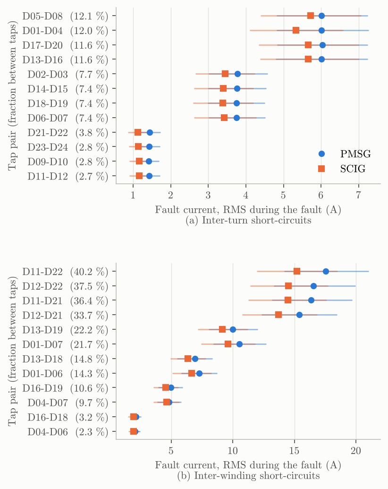
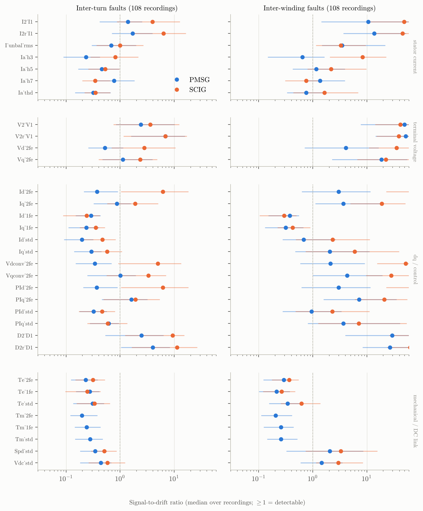
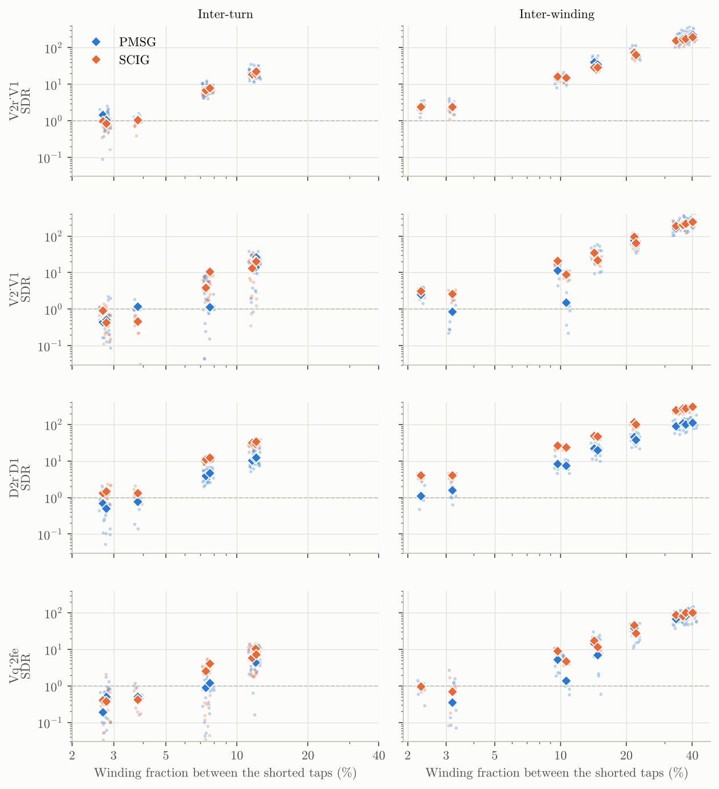
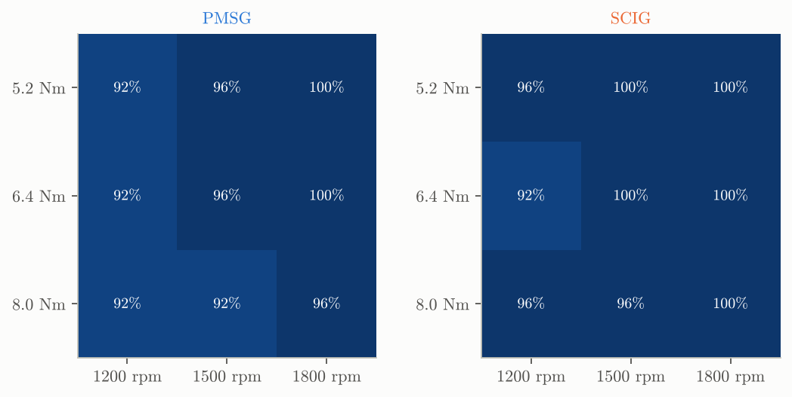
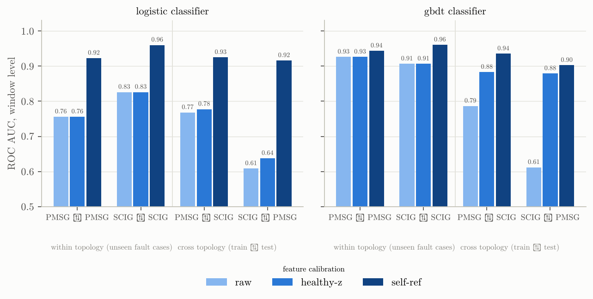

# PMSG vs SCIG under identical winding short-circuits — first comparison

Recordings: 225 per machine (24 fault cases + healthy, × 3 speeds × 3 torques). Windows of 5 electrical cycles, hop 1 cycle. PRE-early = 0.30–0.62 s, PRE-late = 0.62–0.98 s, FLT = relay-on + 30 ms to relay-off − 10 ms. Features use only stator-side / controller signals; `Ifault` and `Fault_relay` are ground truth.

**Detectability statistic.** Signal-to-drift ratio SDR = |relative change of a feature between PRE-late and FLT| ÷ 95th percentile of |relative change between PRE-early and PRE-late| over all 225 recordings of that machine. SDR $\geq 1$ means the change under fault exceeds what ordinary within-recording drift produces in 95 % of healthy segments, i.e. detectable at ≈5 % per-recording false alarm. It is scale-free and directly comparable across features, operating points and topologies.

**Caveat on every number:** one physical machine per topology, no repeated tests. Differences between the two columns are differences between *these two machines*; attributing them to topology needs the simulation populations planned for the paper.

## A. Same tap pair ≠ same physical severity

Mean fault current over the 24 cases: PMSG 6.64 A, SCIG 5.97 A (SCIG/PMSG median 0.91, range 0.78–0.96). In per-unit of rated current: PMSG 1.05, SCIG 0.78. Relative to the pre-fault stator current I1: PMSG 2.63, SCIG 1.13 — the SCIG's magnetising current makes the same fault a much smaller fraction of what the stator sensors see.

| case | sev_pct | phases | Ifault_A_PMSG | Ifault_A_SCIG | ratio_SCIG_over_PMSG | Ifault_over_I1_PMSG | Ifault_over_I1_SCIG |
|---|---|---|---|---|---|---|---|
| TURNS_D11_D12 | 2.700 | AA | 1.428 | 1.161 | 0.813 | 0.560 | 0.219 |
| TURNS_D09_D10 | 2.800 | AA | 1.415 | 1.161 | 0.821 | 0.557 | 0.220 |
| TURNS_D23_D24 | 2.800 | AA | 1.425 | 1.134 | 0.796 | 0.564 | 0.214 |
| TURNS_D21_D22 | 3.800 | AA | 1.436 | 1.125 | 0.783 | 0.569 | 0.212 |
| TURNS_D06_D07 | 7.400 | AA | 3.755 | 3.426 | 0.913 | 1.492 | 0.645 |
| TURNS_D14_D15 | 7.400 | BB | 3.758 | 3.399 | 0.905 | 1.494 | 0.641 |
| TURNS_D18_D19 | 7.400 | AA | 3.744 | 3.383 | 0.904 | 1.484 | 0.637 |
| TURNS_D02_D03 | 7.700 | BB | 3.772 | 3.444 | 0.913 | 1.498 | 0.650 |
| TURNS_D13_D16 | 11.600 | AA | 6.011 | 5.664 | 0.942 | 2.397 | 1.069 |
| TURNS_D17_D20 | 11.600 | CC | 6.040 | 5.654 | 0.936 | 2.409 | 1.067 |
| TURNS_D01_D04 | 12.000 | AA | 6.016 | 5.328 | 0.886 | 2.415 | 1.006 |
| TURNS_D05_D08 | 12.100 | CC | 6.016 | 5.716 | 0.950 | 2.394 | 1.077 |
| WINDINGS_D04_D06 | 2.300 | AA | 2.062 | 1.941 | 0.941 | 0.818 | 0.365 |
| WINDINGS_D16_D18 | 3.200 | AA | 2.140 | 1.933 | 0.903 | 0.836 | 0.364 |
| WINDINGS_D04_D07 | 9.700 | AA | 4.816 | 4.620 | 0.959 | 1.880 | 0.870 |
| WINDINGS_D16_D19 | 10.600 | AA | 4.956 | 4.548 | 0.918 | 1.933 | 0.855 |
| WINDINGS_D01_D06 | 14.300 | AA | 7.268 | 6.667 | 0.917 | 2.898 | 1.258 |
| WINDINGS_D13_D18 | 14.800 | AA | 6.934 | 6.367 | 0.918 | 2.741 | 1.202 |
| WINDINGS_D01_D07 | 21.700 | AA | 10.535 | 9.590 | 0.910 | 4.181 | 1.812 |
| WINDINGS_D13_D19 | 22.200 | AA | 10.010 | 9.158 | 0.915 | 3.967 | 1.727 |
| WINDINGS_D12_D21 | 33.700 | AA | 15.388 | 13.722 | 0.892 | 6.082 | 2.590 |
| WINDINGS_D11_D21 | 36.400 | AA | 16.350 | 14.466 | 0.885 | 6.414 | 2.731 |
| WINDINGS_D12_D22 | 37.500 | AA | 16.558 | 14.521 | 0.877 | 6.503 | 2.741 |
| WINDINGS_D11_D22 | 40.200 | AA | 17.558 | 15.215 | 0.867 | 6.937 | 2.873 |

## B. Where the signature shows up, per topology

Null (95th percentile of |no-fault relative change|) per machine, selected features:

| feature | PMSG | SCIG |
|---|---|---|
| I2_I1 | 0.172 | 0.038 |
| V2_V1 | 0.107 | 0.037 |
| Id_2fe | 0.774 | 0.017 |
| Iq_2fe | 0.228 | 0.069 |
| PIq_2fe | 0.112 | 0.064 |
| Vq_2fe | 0.197 | 0.066 |
| Ia_h3 | 0.229 | 0.044 |
| Te_2fe | 0.955 | 0.745 |
| Vdc_std | 0.003 | 0.005 |

Top-6 features by median SDR per machine and fault type (`median_delta` = median relative change, sign = direction):

| machine | ftype | feature | group | median_sdr | frac_detectable | healthy_false_alarm | median_delta |
|---|---|---|---|---|---|---|---|
| SCIG | WINDINGS | D2_D1 | dq / control | 71.825 | 1.000 | 0.333 | 0.854 |
| SCIG | WINDINGS | PId_2fe | dq / control | 68.446 | 1.000 | 0.111 | 1.188 |
| SCIG | WINDINGS | Id_2fe | dq / control | 68.376 | 1.000 | 0.111 | 1.188 |
| SCIG | WINDINGS | D2r_D1 | dq / control | 62.907 | 1.000 | 0.222 | 1.017 |
| PMSG | WINDINGS | V2r_V1 | terminal voltage | 52.720 | 1.000 | 0.000 | 6.509 |
| SCIG | WINDINGS | Vdconv_2fe | dq / control | 52.559 | 1.000 | 0.111 | 1.203 |
| PMSG | WINDINGS | V2_V1 | terminal voltage | 49.911 | 0.907 | 0.000 | 5.318 |
| SCIG | WINDINGS | I2_I1 | stator current | 48.869 | 0.991 | 0.000 | 1.869 |
| PMSG | WINDINGS | D2_D1 | dq / control | 29.270 | 0.898 | 0.000 | 2.942 |
| PMSG | WINDINGS | D2r_D1 | dq / control | 26.908 | 0.963 | 0.000 | 3.704 |
| PMSG | WINDINGS | Vq_2fe | terminal voltage | 18.744 | 0.889 | 0.000 | 3.688 |
| PMSG | WINDINGS | I2r_I1 | stator current | 13.727 | 0.861 | 0.000 | 3.316 |
| SCIG | TURNS | D2r_D1 | dq / control | 11.246 | 0.926 | 0.222 | 0.182 |
| SCIG | TURNS | D2_D1 | dq / control | 9.360 | 0.769 | 0.333 | 0.017 |
| SCIG | TURNS | V2r_V1 | terminal voltage | 6.899 | 0.815 | 0.000 | 0.354 |
| PMSG | TURNS | V2r_V1 | terminal voltage | 6.839 | 0.880 | 0.000 | 0.844 |
| SCIG | TURNS | I2r_I1 | stator current | 6.341 | 0.852 | 0.111 | 0.294 |
| SCIG | TURNS | PId_2fe | dq / control | 6.182 | 0.759 | 0.111 | 0.015 |
| SCIG | TURNS | Id_2fe | dq / control | 6.177 | 0.759 | 0.111 | 0.015 |
| PMSG | TURNS | D2r_D1 | dq / control | 3.996 | 0.750 | 0.000 | 0.550 |
| PMSG | TURNS | D2_D1 | dq / control | 2.493 | 0.611 | 0.000 | 0.010 |
| PMSG | TURNS | V2_V1 | terminal voltage | 2.411 | 0.685 | 0.000 | 0.003 |
| PMSG | TURNS | I2r_I1 | stator current | 1.705 | 0.704 | 0.000 | 0.412 |
| PMSG | TURNS | PIq_2fe | dq / control | 1.614 | 0.620 | 0.111 | -0.028 |

Share of fault recordings in which each signal group holds the strongest signature:

| machine | ftype | group | representative_feature | share_of_recordings_where_group_is_strongest |
|---|---|---|---|---|
| PMSG | TURNS | stator current | I2r_I1 | 0.028 |
| PMSG | TURNS | terminal voltage | V2r_V1 | 0.935 |
| PMSG | TURNS | dq / control | D2r_D1 | 0.009 |
| PMSG | TURNS | mechanical / DC link | Vdc_std | 0.028 |
| PMSG | WINDINGS | stator current | I2r_I1 | 0.000 |
| PMSG | WINDINGS | terminal voltage | V2r_V1 | 0.972 |
| PMSG | WINDINGS | dq / control | D2_D1 | 0.028 |
| PMSG | WINDINGS | mechanical / DC link | Spd_std | 0.000 |
| SCIG | TURNS | stator current | I2r_I1 | 0.343 |
| SCIG | TURNS | terminal voltage | V2r_V1 | 0.028 |
| SCIG | TURNS | dq / control | D2r_D1 | 0.630 |
| SCIG | TURNS | mechanical / DC link | Vdc_std | 0.000 |
| SCIG | WINDINGS | stator current | I2_I1 | 0.333 |
| SCIG | WINDINGS | terminal voltage | V2_V1 | 0.000 |
| SCIG | WINDINGS | dq / control | PId_2fe | 0.667 |
| SCIG | WINDINGS | mechanical / DC link | Spd_std | 0.000 |

## C. Minimum detectable fault extent

Features with the highest pooled median SDR (both machines): V2r_V1, V2_V1, D2r_D1, Vq_2fe. Smallest tap-pair severity level whose median SDR is $\geq 1$:

| machine | ftype | feature | min_detectable_sev_pct | min_detectable_first_pct | n_sev_levels | n_levels_detectable | spearman_sdr_vs_sev |
|---|---|---|---|---|---|---|---|
| PMSG | TURNS | V2r_V1 | 2.700 | 2.700 | 8 | 8 | 0.909 |
| PMSG | TURNS | V2_V1 | 3.800 | 3.800 | 8 | 6 | 0.790 |
| PMSG | TURNS | D2r_D1 | 7.400 | 7.400 | 8 | 5 | 0.908 |
| PMSG | TURNS | Vq_2fe | 7.700 | 7.700 | 8 | 4 | 0.775 |
| PMSG | WINDINGS | V2r_V1 | 2.300 | 2.300 | 12 | 12 | 0.956 |
| PMSG | WINDINGS | V2_V1 | 9.700 | 2.300 | 12 | 11 | 0.925 |
| PMSG | WINDINGS | D2r_D1 | 2.300 | 2.300 | 12 | 12 | 0.952 |
| PMSG | WINDINGS | Vq_2fe | 9.700 | 2.300 | 12 | 11 | 0.910 |
| SCIG | TURNS | V2r_V1 | 3.800 | 3.800 | 8 | 6 | 0.921 |
| SCIG | TURNS | V2_V1 | 7.400 | 7.400 | 8 | 5 | 0.832 |
| SCIG | TURNS | D2r_D1 | 2.700 | 2.700 | 8 | 8 | 0.918 |
| SCIG | TURNS | Vq_2fe | 7.400 | 7.400 | 8 | 5 | 0.794 |
| SCIG | WINDINGS | V2r_V1 | 2.300 | 2.300 | 12 | 12 | 0.962 |
| SCIG | WINDINGS | V2_V1 | 2.300 | 2.300 | 12 | 12 | 0.947 |
| SCIG | WINDINGS | D2r_D1 | 2.300 | 2.300 | 12 | 12 | 0.964 |
| SCIG | WINDINGS | Vq_2fe | 9.700 | 9.700 | 12 | 10 | 0.952 |

## D. Operating-point dependence

| machine | speed_rpm | torque_Nm | median_best_sdr | frac_detectable |
|---|---|---|---|---|
| PMSG | 1200 | 5.200 | 12.791 | 0.917 |
| PMSG | 1200 | 6.400 | 12.230 | 0.917 |
| PMSG | 1200 | 8.000 | 10.750 | 0.917 |
| PMSG | 1500 | 5.200 | 17.431 | 0.958 |
| PMSG | 1500 | 6.400 | 16.127 | 0.958 |
| PMSG | 1500 | 8.000 | 14.213 | 0.917 |
| PMSG | 1800 | 5.200 | 23.751 | 1.000 |
| PMSG | 1800 | 6.400 | 21.999 | 1.000 |
| PMSG | 1800 | 8.000 | 20.421 | 0.958 |
| SCIG | 1200 | 5.200 | 24.462 | 0.958 |
| SCIG | 1200 | 6.400 | 23.053 | 0.917 |
| SCIG | 1200 | 8.000 | 21.356 | 0.958 |
| SCIG | 1500 | 5.200 | 29.591 | 1.000 |
| SCIG | 1500 | 6.400 | 28.621 | 1.000 |
| SCIG | 1500 | 8.000 | 25.508 | 0.958 |
| SCIG | 1800 | 5.200 | 30.123 | 1.000 |
| SCIG | 1800 | 6.400 | 29.920 | 1.000 |
| SCIG | 1800 | 8.000 | 27.577 | 1.000 |

## E. Cross-topology transfer

Window-level detector (1 = fault window of a fault recording; 0 = pre-fault windows of all recordings and fault-time windows of healthy recordings). n windows = 46030; positives = 5882. Within-topology rows use 5-fold GroupKFold over fault cases (unseen tap pairs).

| calibration | model | train | test | setting | auc | tpr_at_1pct_fpr | n_test |
|---|---|---|---|---|---|---|---|
| raw | logistic | PMSG | PMSG | within (unseen cases) | 0.756 | 0.589 | 23204 |
| raw | logistic | SCIG | SCIG | within (unseen cases) | 0.826 | 0.621 | 22826 |
| raw | logistic | PMSG | SCIG | cross-topology | 0.768 | 0.540 | 22826 |
| raw | logistic | SCIG | PMSG | cross-topology | 0.608 | 0.324 | 23204 |
| raw | gbdt | PMSG | PMSG | within (unseen cases) | 0.926 | 0.741 | 23204 |
| raw | gbdt | SCIG | SCIG | within (unseen cases) | 0.907 | 0.673 | 22826 |
| raw | gbdt | PMSG | SCIG | cross-topology | 0.786 | 0.246 | 22826 |
| raw | gbdt | SCIG | PMSG | cross-topology | 0.612 | 0.262 | 23204 |
| healthy-z | logistic | PMSG | PMSG | within (unseen cases) | 0.756 | 0.589 | 23204 |
| healthy-z | logistic | SCIG | SCIG | within (unseen cases) | 0.826 | 0.621 | 22826 |
| healthy-z | logistic | PMSG | SCIG | cross-topology | 0.777 | 0.604 | 22826 |
| healthy-z | logistic | SCIG | PMSG | cross-topology | 0.638 | 0.367 | 23204 |
| healthy-z | gbdt | PMSG | PMSG | within (unseen cases) | 0.926 | 0.741 | 23204 |
| healthy-z | gbdt | SCIG | SCIG | within (unseen cases) | 0.907 | 0.673 | 22826 |
| healthy-z | gbdt | PMSG | SCIG | cross-topology | 0.883 | 0.504 | 22826 |
| healthy-z | gbdt | SCIG | PMSG | cross-topology | 0.879 | 0.547 | 23204 |
| self-ref | logistic | PMSG | PMSG | within (unseen cases) | 0.923 | 0.760 | 23204 |
| self-ref | logistic | SCIG | SCIG | within (unseen cases) | 0.960 | 0.830 | 22826 |
| self-ref | logistic | PMSG | SCIG | cross-topology | 0.925 | 0.798 | 22826 |
| self-ref | logistic | SCIG | PMSG | cross-topology | 0.916 | 0.718 | 23204 |
| self-ref | gbdt | PMSG | PMSG | within (unseen cases) | 0.944 | 0.779 | 23204 |
| self-ref | gbdt | SCIG | SCIG | within (unseen cases) | 0.961 | 0.826 | 22826 |
| self-ref | gbdt | PMSG | SCIG | cross-topology | 0.935 | 0.809 | 22826 |
| self-ref | gbdt | SCIG | PMSG | cross-topology | 0.903 | 0.555 | 23204 |

Cosine similarity of the two logistic weight vectors (healthy-z features), PMSG vs SCIG: **0.44** (1 = identical feature weighting).

Largest-weight features (healthy-z logistic):

| feature | PMSG | SCIG | abs_mean |
|---|---|---|---|
| V2_V1 | 8.535 | 3.346 | 5.940 |
| V2c_im | -4.871 | -2.718 | 3.795 |
| D2c_im | -5.159 | -2.020 | 3.589 |
| V2c_re | -2.397 | 4.674 | 3.535 |
| D2_D1 | 3.969 | 2.881 | 3.425 |
| I2_I1 | 0.657 | 6.152 | 3.404 |
| Vq_2fe | 3.649 | 0.836 | 2.243 |
| Iq_2fe | 2.539 | 0.617 | 1.578 |
| Iq_std | -1.066 | -2.046 | 1.556 |
| Id_2fe | 0.590 | 2.295 | 1.443 |
| Vd_2fe | 0.147 | 2.723 | 1.435 |
| Vdconv_2fe | -0.986 | 1.842 | 1.414 |

