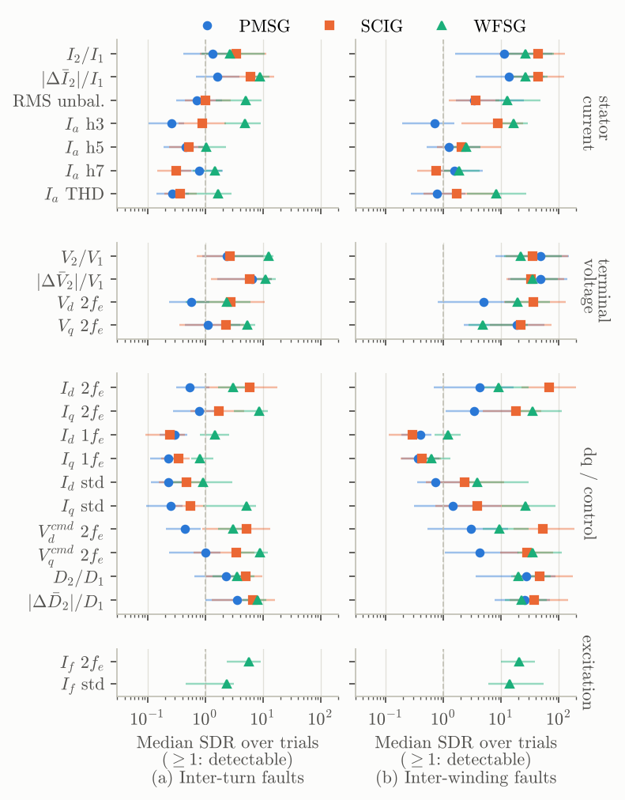
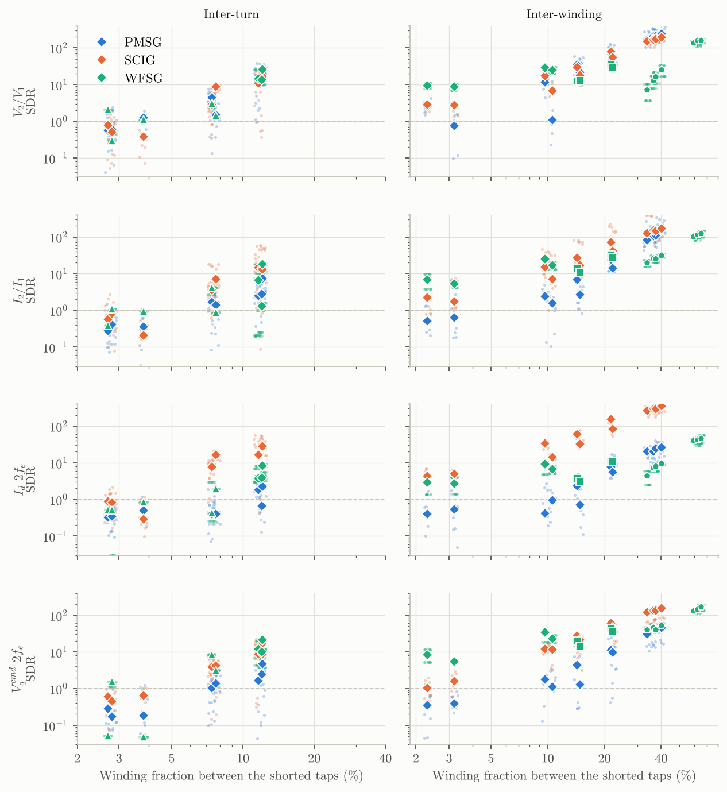
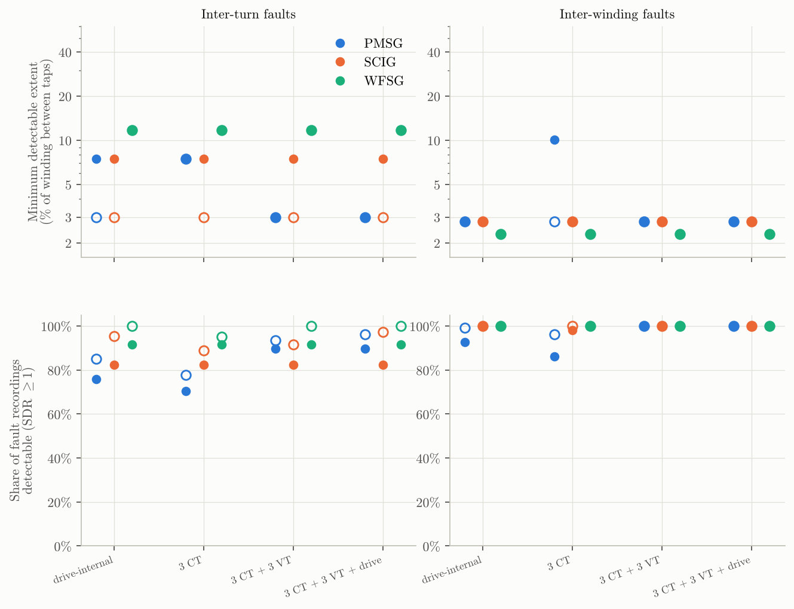
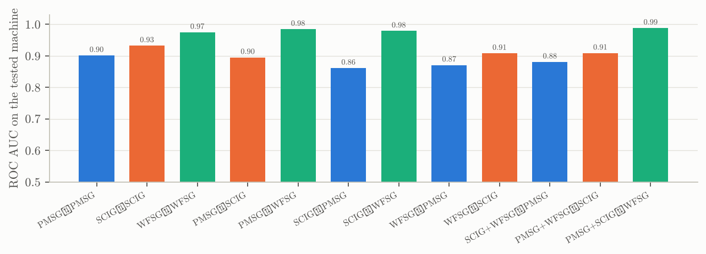

# Three alternatives: PMSG, SCIG, WFSG (3-cycle windows, common features)

Recordings: {'PMSG': 225, 'SCIG': 225, 'WFSG': 438}; WFSG at all fault impedances (coverage: {('TURNS', 1.0): 63, ('TURNS', 2.83): 117, ('WINDINGS', 2.83): 81, ('WINDINGS', 5.66): 36, ('WINDINGS', 11.32): 141}).

## Null (95th percentile of |no-fault relative change|)

| feature | PMSG | SCIG | WFSG |
|---|---|---|---|
| V2_V1 | 0.100 | 0.043 | 0.033 |
| I2_I1 | 0.166 | 0.040 | 0.082 |
| Id_2fe | 0.476 | 0.017 | 0.178 |
| Vqconv_2fe | 0.187 | 0.039 | 0.078 |
| If_2fe |  |  | 0.361 |

## Fault current per tap pair (median over recordings)

| ('case', '') | ('ftype', '') | ('sev_pct', '') | ('Ifault_A', 'PMSG') | ('Ifault_A', 'SCIG') | ('Ifault_A', 'WFSG') | ('Ifault_over_I1', 'PMSG') | ('Ifault_over_I1', 'SCIG') | ('Ifault_over_I1', 'WFSG') |
|---|---|---|---|---|---|---|---|---|
| TURNS_D01_D04 | TURNS | 12.000 | 5.850 | 5.159 | 5.082 | 2.305 | 1.001 | 4.841 |
| TURNS_D02_D03 | TURNS | 7.700 | 3.683 | 3.370 | 3.296 | 1.454 | 0.650 | 2.982 |
| TURNS_D05_D08 | TURNS | 12.100 | 5.928 | 5.598 | 5.067 | 2.340 | 1.047 | 4.797 |
| TURNS_D06_D07 | TURNS | 7.400 | 3.673 | 3.330 | 3.334 | 1.442 | 0.637 | 2.975 |
| TURNS_D09_D10 | TURNS | 2.800 | 1.398 | 1.123 | 1.293 | 0.533 | 0.214 | 1.151 |
| TURNS_D11_D12 | TURNS | 2.700 | 1.409 | 1.131 | 1.307 | 0.549 | 0.215 | 1.165 |
| TURNS_D13_D16 | TURNS | 11.600 | 5.872 | 5.522 | 5.015 | 2.309 | 1.056 | 4.662 |
| TURNS_D14_D15 | TURNS | 7.400 | 3.698 | 3.286 | 4.252 | 1.456 | 0.623 | 3.797 |
| TURNS_D17_D20 | TURNS | 11.600 | 5.904 | 5.546 | 4.977 | 2.338 | 1.056 | 4.657 |
| TURNS_D18_D19 | TURNS | 7.400 | 3.674 | 3.307 | 3.302 | 1.438 | 0.630 | 2.958 |
| TURNS_D21_D22 | TURNS | 3.800 | 1.414 | 1.087 | 1.313 | 0.553 | 0.204 | 1.177 |
| TURNS_D23_D24 | TURNS | 2.800 | 1.406 | 1.087 | 1.315 | 0.556 | 0.203 | 1.173 |
| WINDINGS_D01_D06 | WINDINGS | 14.300 | 7.113 | 6.478 | 3.360 | 2.831 | 1.233 | 3.085 |
| WINDINGS_D01_D07 | WINDINGS | 21.700 | 10.352 | 9.469 | 4.832 | 4.064 | 1.803 | 4.392 |
| WINDINGS_D04_D06 | WINDINGS | 2.300 | 2.003 | 1.908 | 3.142 | 0.778 | 0.362 | 2.839 |
| WINDINGS_D04_D07 | WINDINGS | 9.700 | 4.699 | 4.507 | 5.223 | 1.819 | 0.855 | 4.743 |
| WINDINGS_D09_D23 | WINDINGS | 62.500 |  |  | 5.683 |  |  | 5.153 |
| WINDINGS_D09_D24 | WINDINGS | 65.300 |  |  | 5.922 |  |  | 5.435 |
| WINDINGS_D10_D23 | WINDINGS | 59.700 |  |  | 5.560 |  |  | 5.048 |
| WINDINGS_D10_D24 | WINDINGS | 62.500 |  |  | 6.364 |  |  | 5.746 |
| WINDINGS_D11_D21 | WINDINGS | 36.400 | 16.010 | 14.225 | 3.574 | 6.174 | 2.678 | 3.232 |
| WINDINGS_D11_D22 | WINDINGS | 40.200 | 17.111 | 14.910 | 3.821 | 6.656 | 2.839 | 3.448 |
| WINDINGS_D12_D21 | WINDINGS | 33.700 | 15.158 | 13.373 | 3.312 | 5.927 | 2.551 | 2.970 |
| WINDINGS_D12_D22 | WINDINGS | 37.500 | 16.190 | 14.179 | 3.566 | 6.380 | 2.705 | 3.199 |
| WINDINGS_D13_D18 | WINDINGS | 14.800 | 6.828 | 6.279 | 2.635 | 2.656 | 1.193 | 2.497 |
| WINDINGS_D13_D19 | WINDINGS | 22.200 | 9.812 | 8.928 | 3.944 | 3.838 | 1.712 | 3.685 |
| WINDINGS_D16_D18 | WINDINGS | 3.200 | 2.096 | 1.902 | 2.456 | 0.823 | 0.363 | 2.242 |
| WINDINGS_D16_D19 | WINDINGS | 10.600 | 4.884 | 4.422 | 3.640 | 1.886 | 0.836 | 3.352 |

## Per-feature SDR (top 6 per machine and fault type)

| machine | ftype | feature | group | n | median_sdr | frac_detectable | healthy_false_alarm |
|---|---|---|---|---|---|---|---|
| SCIG | WINDINGS | Id_2fe | dq / control | 108 | 66.979 | 1.000 | 0.000 |
| SCIG | WINDINGS | Vdconv_2fe | dq / control | 108 | 53.244 | 1.000 | 0.111 |
| PMSG | WINDINGS | V2_V1 | terminal voltage | 108 | 48.633 | 0.907 | 0.111 |
| PMSG | WINDINGS | V2r_V1 | terminal voltage | 108 | 48.350 | 1.000 | 0.111 |
| SCIG | WINDINGS | D2_D1 | dq / control | 108 | 46.206 | 1.000 | 0.333 |
| SCIG | WINDINGS | I2_I1 | stator current | 108 | 43.479 | 0.981 | 0.000 |
| SCIG | WINDINGS | I2r_I1 | stator current | 108 | 43.382 | 0.981 | 0.000 |
| SCIG | WINDINGS | D2r_D1 | dq / control | 108 | 37.475 | 1.000 | 0.111 |
| WFSG | WINDINGS | Vqconv_2fe | dq / control | 258 | 35.434 | 1.000 |  |
| WFSG | WINDINGS | V2r_V1 | terminal voltage | 258 | 35.250 | 1.000 |  |
| WFSG | WINDINGS | Iq_2fe | dq / control | 258 | 35.201 | 1.000 |  |
| PMSG | WINDINGS | D2_D1 | dq / control | 108 | 27.491 | 0.907 | 0.000 |
| WFSG | WINDINGS | Iq_std | dq / control | 258 | 26.672 | 1.000 |  |
| WFSG | WINDINGS | I2r_I1 | stator current | 258 | 26.426 | 1.000 |  |
| WFSG | WINDINGS | I2_I1 | stator current | 258 | 26.360 | 1.000 |  |
| PMSG | WINDINGS | D2r_D1 | dq / control | 108 | 25.201 | 0.926 | 0.000 |
| PMSG | WINDINGS | Vq_2fe | terminal voltage | 108 | 18.811 | 0.889 | 0.000 |
| PMSG | WINDINGS | I2r_I1 | stator current | 108 | 13.406 | 0.861 | 0.000 |
| WFSG | TURNS | V2_V1 | terminal voltage | 180 | 12.508 | 0.917 |  |
| WFSG | TURNS | V2r_V1 | terminal voltage | 180 | 10.952 | 0.917 |  |
| WFSG | TURNS | I2r_I1 | stator current | 180 | 8.926 | 0.917 |  |
| WFSG | TURNS | Vqconv_2fe | dq / control | 180 | 8.777 | 0.917 |  |
| WFSG | TURNS | Iq_2fe | dq / control | 180 | 8.722 | 0.917 |  |
| WFSG | TURNS | D2r_D1 | dq / control | 180 | 8.059 | 0.917 |  |
| SCIG | TURNS | D2r_D1 | dq / control | 108 | 6.689 | 0.824 | 0.111 |
| PMSG | TURNS | V2r_V1 | terminal voltage | 108 | 6.517 | 0.898 | 0.111 |
| SCIG | TURNS | I2r_I1 | stator current | 108 | 6.039 | 0.824 | 0.000 |
| SCIG | TURNS | Id_2fe | dq / control | 108 | 5.986 | 0.731 | 0.000 |
| SCIG | TURNS | V2r_V1 | terminal voltage | 108 | 5.907 | 0.778 | 0.000 |
| SCIG | TURNS | Vdconv_2fe | dq / control | 108 | 5.146 | 0.713 | 0.111 |
| SCIG | TURNS | D2_D1 | dq / control | 108 | 4.993 | 0.750 | 0.333 |
| PMSG | TURNS | D2r_D1 | dq / control | 108 | 3.552 | 0.759 | 0.000 |
| PMSG | TURNS | V2_V1 | terminal voltage | 108 | 2.357 | 0.704 | 0.111 |
| PMSG | TURNS | D2_D1 | dq / control | 108 | 2.269 | 0.630 | 0.000 |
| PMSG | TURNS | I2r_I1 | stator current | 108 | 1.649 | 0.704 | 0.000 |
| PMSG | TURNS | I2_I1 | stator current | 108 | 1.329 | 0.556 | 0.000 |

## Sensor suites

| suite | machine | ftype | best_feature | n_trials | n_features | fixed_median_sdr | fixed_share_detectable | fixed_min_detectable_pct | fixed_mde_bracket_lo_pct | fixed_min_detectable_first_pct | smallest_extent_tested_pct | fixed_healthy_false_alarm | fixed_fa_wilson_lo | fixed_fa_wilson_hi | n_healthy | oracle_share_detectable | oracle_min_detectable_pct | oracle_healthy_false_alarm | oracle_threshold | oracle_share_calibrated | oracle_fa_calibrated |
|---|---|---|---|---|---|---|---|---|---|---|---|---|---|---|---|---|---|---|---|---|---|
| drive-internal | PMSG | TURNS | D2r_D1 | 108 | 15 | 3.552 | 0.759 | 7.500 | 3.000 | 7.500 | 3.000 | 0.000 | 0.000 | 0.299 | 9 | 0.852 | 3.000 | 0.444 | 1.965 | 0.676 | 0.000 |
| 3 CT | PMSG | TURNS | I2r_I1 | 108 | 7 | 1.649 | 0.704 | 7.500 | 3.000 | 7.500 | 3.000 | 0.000 | 0.000 | 0.299 | 9 | 0.778 | 7.500 | 0.000 | 1.533 | 0.630 | 0.000 |
| 3 CT + 3 VT | PMSG | TURNS | V2r_V1 | 108 | 9 | 6.517 | 0.898 | 3.000 |  | 3.000 | 3.000 | 0.111 | 0.020 | 0.435 | 9 | 0.935 | 3.000 | 0.222 | 1.593 | 0.759 | 0.000 |
| 3 CT + 3 VT + drive | PMSG | TURNS | V2r_V1 | 108 | 26 | 6.517 | 0.898 | 3.000 |  | 3.000 | 3.000 | 0.111 | 0.020 | 0.435 | 9 | 0.963 | 3.000 | 0.556 | 2.008 | 0.713 | 0.000 |
| drive-internal | PMSG | WINDINGS | D2r_D1 | 108 | 15 | 25.201 | 0.926 | 2.800 |  | 2.800 | 2.800 | 0.000 | 0.000 | 0.299 | 9 | 0.991 | 2.800 | 0.444 | 1.965 | 0.880 | 0.000 |
| 3 CT | PMSG | WINDINGS | I2r_I1 | 108 | 7 | 13.406 | 0.861 | 10.100 | 2.800 | 10.100 | 2.800 | 0.000 | 0.000 | 0.299 | 9 | 0.963 | 2.800 | 0.000 | 1.533 | 0.889 | 0.000 |
| 3 CT + 3 VT | PMSG | WINDINGS | V2r_V1 | 108 | 9 | 48.350 | 1.000 | 2.800 |  | 2.800 | 2.800 | 0.111 | 0.020 | 0.435 | 9 | 1.000 | 2.800 | 0.222 | 1.593 | 0.981 | 0.000 |
| 3 CT + 3 VT + drive | PMSG | WINDINGS | V2r_V1 | 108 | 26 | 48.350 | 1.000 | 2.800 |  | 2.800 | 2.800 | 0.111 | 0.020 | 0.435 | 9 | 1.000 | 2.800 | 0.556 | 2.008 | 0.963 | 0.000 |
| drive-internal | SCIG | TURNS | D2r_D1 | 108 | 14 | 6.689 | 0.824 | 7.500 | 3.000 | 7.500 | 3.000 | 0.111 | 0.020 | 0.435 | 9 | 0.954 | 3.000 | 0.778 | 1.829 | 0.694 | 0.000 |
| 3 CT | SCIG | TURNS | I2r_I1 | 108 | 7 | 6.039 | 0.824 | 7.500 | 3.000 | 7.500 | 3.000 | 0.000 | 0.000 | 0.299 | 9 | 0.889 | 3.000 | 0.556 | 1.502 | 0.778 | 0.111 |
| 3 CT + 3 VT | SCIG | TURNS | I2r_I1 | 108 | 9 | 6.039 | 0.824 | 7.500 | 3.000 | 7.500 | 3.000 | 0.000 | 0.000 | 0.299 | 9 | 0.917 | 3.000 | 0.556 | 1.622 | 0.769 | 0.111 |
| 3 CT + 3 VT + drive | SCIG | TURNS | D2r_D1 | 108 | 25 | 6.689 | 0.824 | 7.500 | 3.000 | 7.500 | 3.000 | 0.111 | 0.020 | 0.435 | 9 | 0.972 | 3.000 | 0.889 | 2.008 | 0.722 | 0.111 |
| drive-internal | SCIG | WINDINGS | Id_2fe | 108 | 14 | 66.979 | 1.000 | 2.800 |  | 2.800 | 2.800 | 0.000 | 0.000 | 0.299 | 9 | 1.000 | 2.800 | 0.778 | 1.829 | 1.000 | 0.000 |
| 3 CT | SCIG | WINDINGS | I2_I1 | 108 | 7 | 43.479 | 0.981 | 2.800 |  | 2.800 | 2.800 | 0.000 | 0.000 | 0.299 | 9 | 1.000 | 2.800 | 0.556 | 1.502 | 0.972 | 0.111 |
| 3 CT + 3 VT | SCIG | WINDINGS | V2_V1 | 108 | 9 | 34.676 | 1.000 | 2.800 |  | 2.800 | 2.800 | 0.222 | 0.063 | 0.547 | 9 | 1.000 | 2.800 | 0.556 | 1.622 | 0.981 | 0.111 |
| 3 CT + 3 VT + drive | SCIG | WINDINGS | Id_2fe | 108 | 25 | 66.979 | 1.000 | 2.800 |  | 2.800 | 2.800 | 0.000 | 0.000 | 0.299 | 9 | 1.000 | 2.800 | 0.889 | 2.008 | 1.000 | 0.111 |
| drive-internal | WFSG | TURNS | Vqconv_2fe | 180 | 14 | 8.777 | 0.917 | 11.800 |  | 11.800 | 11.800 |  |  |  | 0 | 1.000 | 11.800 |  | 1.649 | 0.933 |  |
| 3 CT | WFSG | TURNS | I2r_I1 | 180 | 7 | 8.926 | 0.917 | 11.800 |  | 11.800 | 11.800 |  |  |  | 0 | 0.950 | 11.800 |  | 1.479 | 0.867 |  |
| 3 CT + 3 VT | WFSG | TURNS | V2r_V1 | 180 | 9 | 10.952 | 0.917 | 11.800 |  | 11.800 | 11.800 |  |  |  | 0 | 1.000 | 11.800 |  | 1.479 | 0.917 |  |
| 3 CT + 3 VT + drive | WFSG | TURNS | V2r_V1 | 180 | 25 | 10.952 | 0.917 | 11.800 |  | 11.800 | 11.800 |  |  |  | 0 | 1.000 | 11.800 |  | 1.702 | 0.967 |  |
| excitation (WFSG only) | WFSG | TURNS | If_2fe | 180 | 2 | 5.647 | 0.800 | 11.800 |  | 11.800 | 11.800 |  |  |  | 0 | 0.867 | 11.800 |  | 1.309 | 0.867 |  |
| drive-internal | WFSG | WINDINGS | Vqconv_2fe | 258 | 14 | 35.434 | 1.000 | 2.300 |  | 2.300 | 2.300 |  |  |  | 0 | 1.000 | 2.300 |  | 1.649 | 1.000 |  |
| 3 CT | WFSG | WINDINGS | I2_I1 | 258 | 7 | 26.360 | 1.000 | 2.300 |  | 2.300 | 2.300 |  |  |  | 0 | 1.000 | 2.300 |  | 1.479 | 1.000 |  |
| 3 CT + 3 VT | WFSG | WINDINGS | V2_V1 | 258 | 9 | 21.702 | 1.000 | 2.300 |  | 2.300 | 2.300 |  |  |  | 0 | 1.000 | 2.300 |  | 1.479 | 1.000 |  |
| 3 CT + 3 VT + drive | WFSG | WINDINGS | V2_V1 | 258 | 25 | 21.702 | 1.000 | 2.300 |  | 2.300 | 2.300 |  |  |  | 0 | 1.000 | 2.300 |  | 1.702 | 1.000 |  |
| excitation (WFSG only) | WFSG | WINDINGS | If_2fe | 258 | 2 | 20.449 | 1.000 | 2.300 |  | 2.300 | 2.300 |  |  |  | 0 | 1.000 | 2.300 |  | 1.309 | 1.000 |  |

## Transfer (self-ref |z|, GBDT; 69274 windows, 8018 positives)

| train | test | auc | tpr_at_1pct_fpr |
|---|---|---|---|
| PMSG | PMSG | 0.902 | 0.708 |
| SCIG | SCIG | 0.932 | 0.775 |
| WFSG | WFSG | 0.975 | 0.941 |
| PMSG | SCIG | 0.895 | 0.683 |
| PMSG | WFSG | 0.985 | 0.941 |
| SCIG | PMSG | 0.861 | 0.416 |
| SCIG | WFSG | 0.979 | 0.870 |
| WFSG | PMSG | 0.871 | 0.634 |
| WFSG | SCIG | 0.908 | 0.588 |
| SCIG+WFSG | PMSG | 0.881 | 0.582 |
| PMSG+WFSG | SCIG | 0.909 | 0.684 |
| PMSG+SCIG | WFSG | 0.989 | 0.946 |

