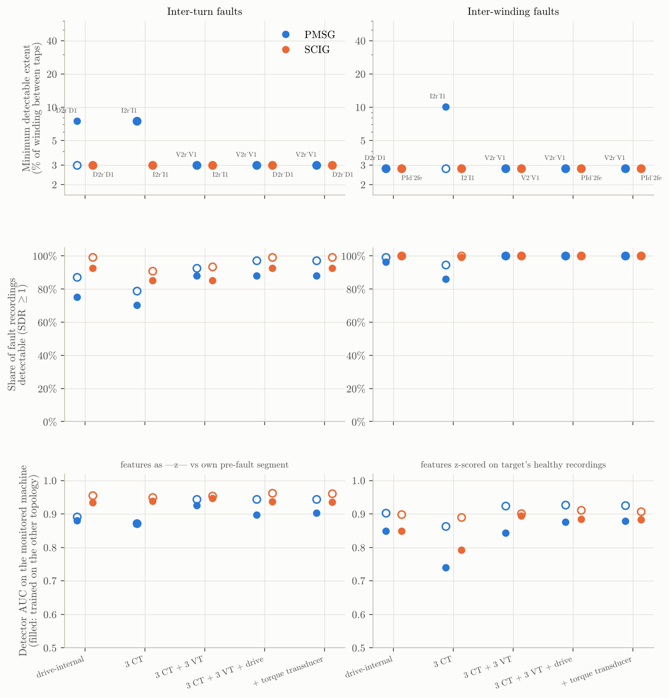

# Sensor-suite analysis — which monitoring architecture detects what, per topology

Suites, ordered by added hardware / integration:

- **drive-internal** — no added sensors; access to the converter controller (19 candidate features)
- **3 CT** — 3 current transducers at the terminals; no angle information (7 candidate features)
- **3 CT + 3 VT** — 3 current + 3 voltage transducers; no angle information (9 candidate features)
- **3 CT + 3 VT + drive** — external transducers plus controller access (dq transform of measured voltages) (30 candidate features)
- **+ torque transducer** — everything above plus a shaft torque transducer (33 candidate features)

Features that fire on more than one of the nine healthy recordings of a machine are excluded for that machine (`excluded` column). `fixed_*` = one feature per suite chosen once by median SDR; `oracle_*` = best feature per recording (upper bound for a multi-feature detector).

| suite | machine | ftype | n_features | best_feature | fixed_median_sdr | fixed_share_detectable | fixed_min_detectable_pct | oracle_share_detectable | oracle_min_detectable_pct | excluded |
|---|---|---|---|---|---|---|---|---|---|---|
| drive-internal | PMSG | TURNS | 19 | D2r_D1 | 3.996 | 0.750 | 7.500 | 0.870 | 3.000 |  |
| 3 CT | PMSG | TURNS | 7 | I2r_I1 | 1.705 | 0.704 | 7.500 | 0.787 | 7.500 |  |
| 3 CT + 3 VT | PMSG | TURNS | 9 | V2r_V1 | 6.839 | 0.880 | 3.000 | 0.926 | 3.000 |  |
| 3 CT + 3 VT + drive | PMSG | TURNS | 30 | V2r_V1 | 6.839 | 0.880 | 3.000 | 0.972 | 3.000 |  |
| + torque transducer | PMSG | TURNS | 33 | V2r_V1 | 6.839 | 0.880 | 3.000 | 0.972 | 3.000 |  |
| drive-internal | PMSG | WINDINGS | 19 | D2r_D1 | 26.908 | 0.963 | 2.800 | 0.991 | 2.800 |  |
| 3 CT | PMSG | WINDINGS | 7 | I2r_I1 | 13.727 | 0.861 | 10.100 | 0.944 | 2.800 |  |
| 3 CT + 3 VT | PMSG | WINDINGS | 9 | V2r_V1 | 52.720 | 1.000 | 2.800 | 1.000 | 2.800 |  |
| 3 CT + 3 VT + drive | PMSG | WINDINGS | 30 | V2r_V1 | 52.720 | 1.000 | 2.800 | 1.000 | 2.800 |  |
| + torque transducer | PMSG | WINDINGS | 33 | V2r_V1 | 52.720 | 1.000 | 2.800 | 1.000 | 2.800 |  |
| drive-internal | SCIG | TURNS | 17 | D2r_D1 | 11.246 | 0.926 | 3.000 | 0.991 | 3.000 | D2_D1,Te_1fe |
| 3 CT | SCIG | TURNS | 7 | I2r_I1 | 6.341 | 0.852 | 3.000 | 0.907 | 3.000 |  |
| 3 CT + 3 VT | SCIG | TURNS | 9 | I2r_I1 | 6.341 | 0.852 | 3.000 | 0.935 | 3.000 |  |
| 3 CT + 3 VT + drive | SCIG | TURNS | 28 | D2r_D1 | 11.246 | 0.926 | 3.000 | 0.991 | 3.000 | D2_D1,Te_1fe |
| + torque transducer | SCIG | TURNS | 31 | D2r_D1 | 11.246 | 0.926 | 3.000 | 0.991 | 3.000 | D2_D1,Te_1fe |
| drive-internal | SCIG | WINDINGS | 17 | PId_2fe | 68.446 | 1.000 | 2.800 | 1.000 | 2.800 | D2_D1,Te_1fe |
| 3 CT | SCIG | WINDINGS | 7 | I2_I1 | 48.869 | 0.991 | 2.800 | 1.000 | 2.800 |  |
| 3 CT + 3 VT | SCIG | WINDINGS | 9 | V2_V1 | 41.954 | 1.000 | 2.800 | 1.000 | 2.800 |  |
| 3 CT + 3 VT + drive | SCIG | WINDINGS | 28 | PId_2fe | 68.446 | 1.000 | 2.800 | 1.000 | 2.800 | D2_D1,Te_1fe |
| + torque transducer | SCIG | WINDINGS | 31 | PId_2fe | 68.446 | 1.000 | 2.800 | 1.000 | 2.800 | D2_D1,Te_1fe |

## Transfer restricted to each suite (GBDT)

| suite | calibration | PMSG→PMSG | PMSG→SCIG | SCIG→PMSG | SCIG→SCIG |
|---|---|---|---|---|---|
| + torque transducer | healthy-z | 0.926 | 0.883 | 0.879 | 0.907 |
| + torque transducer | healthy-z-op | 0.911 | 0.868 | 0.877 | 0.907 |
| + torque transducer | self-ref | 0.944 | 0.935 | 0.903 | 0.961 |
| 3 CT | healthy-z | 0.864 | 0.792 | 0.741 | 0.890 |
| 3 CT | healthy-z-op | 0.832 | 0.886 | 0.831 | 0.874 |
| 3 CT | self-ref | 0.872 | 0.938 | 0.872 | 0.950 |
| 3 CT + 3 VT | healthy-z | 0.925 | 0.895 | 0.843 | 0.901 |
| 3 CT + 3 VT | healthy-z-op | 0.907 | 0.883 | 0.873 | 0.888 |
| 3 CT + 3 VT | self-ref | 0.945 | 0.948 | 0.926 | 0.953 |
| 3 CT + 3 VT + drive | healthy-z | 0.928 | 0.885 | 0.876 | 0.911 |
| 3 CT + 3 VT + drive | healthy-z-op | 0.911 | 0.872 | 0.870 | 0.911 |
| 3 CT + 3 VT + drive | self-ref | 0.944 | 0.937 | 0.897 | 0.962 |
| drive-internal | healthy-z | 0.903 | 0.849 | 0.849 | 0.899 |
| drive-internal | healthy-z-op | 0.894 | 0.860 | 0.827 | 0.905 |
| drive-internal | self-ref | 0.892 | 0.934 | 0.881 | 0.955 |

